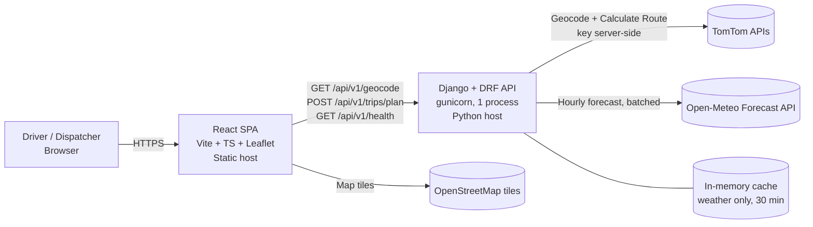

# PROJECT_BLUEPRINT.md — Weather-Aware Truck Routing

> Single source of truth for understanding, designing, implementing, testing and delivering the Spotter **Full Stack Developer — Weather-Aware Truck Routing** assessment.
>
> **Status:** Planning document. Nothing described here is implemented, tested, deployed or measured yet. Every schema, file, component and target below is a *proposal* until the corresponding phase is completed and verified with evidence.

| Version | Date | Change |
|---|---|---|
| 1.0 | 2026-10-12 | Initial blueprint |
| 1.1 | 2026-10-12 | Review revision: ranking now matches the PDF exactly, No Travel moved to a separate eligibility policy, fallback routes made conditional on evidence, checkpoint snapping removed, provider claims re-verified, request volume and complexity reduced |

### Labels used throughout

| Label | Meaning |
|---|---|
| **[PDF]** | Stated in the assessment PDF. Authoritative. Must not be changed. |
| **[ENG]** | Engineering recommendation. Not required by the PDF. |
| **[DEC-n]** | Proposed implementation decision, made because the PDF is silent or ambiguous. Listed in the decision register (§18.2) and in the README. |
| **[OPEN-n]** | Unresolved question or assumption. Listed in §18.3. |
| **[VERIFIED]** | Confirmed in current official provider documentation on 2026-10-12 (sources in §8.7). Documentation only — not yet confirmed by a live call. |
| **[UNVERIFIED]** | Believed true but not yet confirmed. Each item names the phase where it is checked. |
| **[TARGET]** | A goal to measure, not a guarantee. The measured value is recorded in the README. |

---

## Table of Contents

1. [Project Overview](#1-project-overview)
2. [Requirements Specification](#2-requirements-specification)
3. [Business Rules and Domain Logic](#3-business-rules-and-domain-logic)
4. [Technology Stack and Justification](#4-technology-stack-and-justification)
5. [System Architecture](#5-system-architecture)
6. [Frontend Design Specification](#6-frontend-design-specification)
7. [Backend and Service Design](#7-backend-and-service-design)
8. [External API Integration Plan](#8-external-api-integration-plan)
9. [API Contract](#9-api-contract)
10. [Data Model and Internal Types](#10-data-model-and-internal-types)
11. [Implementation Plan](#11-implementation-plan)
12. [Repository Structure](#12-repository-structure)
13. [Testing Strategy](#13-testing-strategy)
14. [Security, Reliability and Performance](#14-security-reliability-and-performance)
15. [Development Environment and Tooling](#15-development-environment-and-tooling)
16. [Deployment Plan](#16-deployment-plan)
17. [Documentation and Demo Plan](#17-documentation-and-demo-plan)
18. [Risks, Decisions and Open Questions](#18-risks-decisions-and-open-questions)
19. [Definition of Done](#19-definition-of-done)
20. [First Actions](#20-first-actions)

---

## 1. Project Overview

### 1.1 Project name

**Weather-Aware Truck Routing** (repository: `weather-aware-truck-routing`).

The author's earlier "RouteWise" concept (HOS-compliance routing) shares only the tech stack. **No RouteWise source code has been provided or inspected.** This project is planned as a fresh codebase. If RouteWise code is later provided, it is audited before any reuse (§20).

### 1.2 Problem statement [PDF]

> Build a React + Django web app that helps a truck driver choose the safest route based on weather, load weight, and travel time.

### 1.3 Objectives

| ID | Objective | Source |
|---|---|---|
| O-1 | Generate 3 route options using a routing API | [PDF] |
| O-2 | Sample weather every 10 / 25 / 50 miles using the truck's ETA at each checkpoint | [PDF] |
| O-3 | Calculate weather risk using the provided risk/load rules | [PDF] |
| O-4 | Recommend the best route using the stated priority order | [PDF] |
| O-5 | Show routes, checkpoints, risk levels, ETAs and route summaries on a map; show a corridor weather heatmap with a 0–48 h slider | [PDF] |
| O-6 | Deliver a GitHub repo, hosted app and 5–10 min Loom walkthrough | [PDF] |
| O-7 | Make every interpretation of an ambiguous rule explicit and tested | [ENG] |

### 1.4 Target users

- **Primary:** a truck driver or dispatcher planning one trip in the continental US.
- **Actual audience:** Spotter assessors evaluating logic correctness, UI smoothness, code quality and documentation.

### 1.5 Expected outcome

A hosted app where the user enters origin, destination, departure time, load weight and checkpoint interval, and sees the routes on a map with risk-coloured checkpoints and ETAs, a ranked comparison with a recommendation explained in plain language, and a corridor heatmap that changes instantly with a 0–48 h slider.

### 1.6 Success criteria

| ID | Criterion | Evidence |
|---|---|---|
| SC-1 | For the demo trip, the app shows 3 routes obtained from the routing API, with the source of each route stated | Live smoke test log (§13.7) + Loom |
| SC-2 | All boundary tests in §13.3 pass | `pytest` output |
| SC-3 | All ranking and eligibility tests in §13.4 pass | `pytest` output |
| SC-4 | Moving the slider makes **zero** network requests | DevTools Network panel, shown in Loom |
| SC-5 | [TARGET] Slider step feels immediate (aim < 100 ms per step on a normal laptop) | DevTools Performance recording; measured value in README |
| SC-6 | [TARGET] Plan request for a ~1,000-mile trip at 25-mile interval completes in well under the server timeout (aim < 15 s cold) | Timed live request; measured value in README |
| SC-7 | No API key in the frontend bundle, Git history, logs or responses | `grep` checks (§14.1) |
| SC-8 | README documents every [DEC-n] and [OPEN-n] | README review |

### 1.7 Scope and constraints

- [PDF] React frontend, Django backend; third-party routing, geocoding and weather APIs allowed; no routing engine needed; "Prioritize correctness and clarity over extra features."
- [ENG] Free provider tiers only (§8).
- [DEC-1] Continental US only. The PDF uses mph and lb. Geocoding is restricted to the US.
- [DEC-2] One trip per request; stateless backend; no accounts, no saved trips, no database models.

---

## 2. Requirements Specification

### 2.1 Functional requirements

| ID | Requirement | Source |
|---|---|---|
| FR-1 | User enters origin | [PDF] |
| FR-2 | User enters destination | [PDF] |
| FR-3 | User enters departure date/time | [PDF] |
| FR-4 | User enters load weight | [PDF] |
| FR-5 | Generate 3 route options using a routing API | [PDF] |
| FR-6 | Sample weather every 10 / 25 / 50 miles | [PDF] |
| FR-7 | Use the truck's estimated arrival time at each checkpoint for the forecast | [PDF] |
| FR-8 | Calculate weather risk using the provided risk/load rules | [PDF] |
| FR-9 | Recommend the best route, balancing weather risk and travel time, preferring: 1. fewest Severe miles, 2. fewest High miles, 3. lowest average risk, 4. shortest travel times | [PDF] |
| FR-10 | Show all routes, checkpoints, risk levels, ETAs and route summaries on a map | [PDF] |
| FR-11 | Show a weather heatmap along the trip corridor with a 0–48 hour forecast slider | [PDF] |
| FR-12 | User chooses the checkpoint interval: 10, 25 or 50 miles | [DEC-3] interpretation of FR-6 |
| FR-13 | User picks each location from geocoder candidates before planning | [DEC-4] avoids silently choosing the wrong "Springfield" |
| FR-14 | Explain which priority criterion decided the recommendation | [ENG] |
| FR-15 | Clearly flag No Travel segments, unknown weather, and the case where no route can be recommended | [ENG] follows from §3 |

### 2.2 Non-functional requirements

| ID | Requirement | Measure | Source |
|---|---|---|---|
| NFR-1 | Correct risk and ranking logic | §13.3–§13.4 pass | [PDF] 40% weight |
| NFR-2 | Smooth map, heatmap and slider | SC-4, SC-5 | [PDF] 35% weight |
| NFR-3 | Readable, tested code | Domain logic in pure functions; typed frontend; lint clean | [PDF] 10% weight |
| NFR-4 | Documentation | README + Loom | [PDF] 5% weight |
| NFR-5 | Security | Keys server-side only; validated inputs; restricted CORS | [ENG] |
| NFR-6 | Reliability | Every external call has a timeout; failures give a typed error or a labelled degraded result — never a crash, never silent Low risk | [ENG] |
| NFR-7 | Accessibility | Keyboard-operable form and slider; risk shown as text as well as colour | [ENG] |
| NFR-8 | Responsive | Usable at 375 px and 1440 px | [ENG] |
| NFR-9 | Deterministic | Same inputs + same provider data → same ranking | [ENG] |

### 2.3 Inputs and outputs

**Inputs** (backend validation is authoritative)

| Input | Format | Validation |
|---|---|---|
| Origin | Geocoded place: label + lat/lon | lat ∈ [−90, 90], lon ∈ [−180, 180] |
| Destination | Geocoded place | Same; must differ from origin by ≥ 1 mile straight-line |
| Departure | ISO 8601 with UTC offset | now ≤ t ≤ now + 7 days [DEC-5] |
| Load weight | Number, lb | 0 ≤ x ≤ 100,000 [DEC-6] (input sanity bound only, not a business rule) |
| Checkpoint interval | Integer | 10, 25 or 50; default 25 [DEC-3] |

**Outputs**

- Routes returned by the routing provider (target 3; see §3.9), each with geometry, distance, travel time, departure/arrival and route summary.
- Per checkpoint: mile marker, coordinates, ETA, forecast values used and their forecast hours, per-condition and overall risk, and a reason string.
- Ranking of all routes by the PDF priority, the recommended route (or why none), and an explanation.
- Corridor forecast grid with risk for hours 0–48 after the departure hour.
- Warnings (fewer than 3 routes, fallback routes used, unknown weather, etc.).

### 2.4 User journeys

**UJ-1 Happy path**
1. Empty US map with the form.
2. Type "Chicago" → Enter/"Find" → pick "Chicago, IL". Same for "Denver, CO".
3. Departure defaults to the next full hour; enter load 42,000 lb; interval 25 mi.
4. "Plan routes" → loading state.
5. Map fits all routes; recommended route drawn thicker and labelled; side panel shows the recommendation sentence and one card per route.
6. Click a checkpoint → popup with ETA, wind/rain/snow values, levels and reason.
7. Drag the slider 0 → 48 h → heatmap recolours immediately; label shows the clock time and "departure + k h".

**UJ-2 Change interval:** switch 25 → 10 mi and re-plan; more checkpoints; risk-miles stay in road miles (§3.6).

**UJ-3 No Travel on some routes:** a route containing No Travel checkpoints keeps its rank but is marked "Not recommended: contains No Travel segments"; the best-ranked route without No Travel is recommended.

**UJ-4 No Travel on every route:** no recommendation; banner explains and suggests a different departure time; ranking still shown.

**UJ-5 Ambiguous location:** "Springfield" → candidates in several states; user picks one.

**UJ-6 Provider failure:** error panel with retry; inputs preserved.

### 2.5 Error and empty states

| State | Trigger | UI |
|---|---|---|
| Initial | First load | US map; form; hint "Enter a trip to compare routes" |
| No geocode result | 0 candidates | Inline field error |
| Validation error | Backend 400 | Field messages; focus first invalid field |
| No route | Provider cannot route | Error panel "No truck route found between these locations" |
| Fewer than 3 routes | Provider returned 1–2 routes and no valid fallback exists | Results shown + warning stating how many routes were found |
| Some weather unknown | Some checkpoints lack forecast data | Grey "Unknown" checkpoints; unknown miles on cards; warning that the recommendation uses incomplete data |
| No weather at all | Every checkpoint unknown | Routes shown; no recommendation; banner |
| No eligible route | Every route has No Travel miles | No recommendation; red banner; ranking shown |
| Rate limited / timeout / network | Upstream 429, timeout, offline | Error panel with retry |
| Slow first response | > 5 s waiting | Text "The server may be starting up; this can take up to a minute" (only if the chosen host has cold starts — [OPEN-9]) |

### 2.6 Mandatory vs optional

| Mandatory | Optional (only after §19 is complete) |
|---|---|
| FR-1 – FR-15 | Slider "play" animation |
| Tests in §13.3–§13.5 | Heatmap variable toggle (risk / wind / rain / snow) |
| Hosted frontend + backend | Truck-position marker at the slider hour |
| README + Loom | Playwright browser test |

### 2.7 Out of scope

- Hours-of-Service, rest breaks, ELD logs, fuel stops (RouteWise features).
- Authentication, accounts, saved trips, payments, database models.
- Turn-by-turn navigation, live traffic display, re-routing.
- Non-US routing, metric UI.
- Weather not in the PDF (ice, fog, visibility, temperature, lightning, gusts) — not used in risk.

### 2.8 Deliverables and evaluation [PDF]

| Deliverable | Plan |
|---|---|
| GitHub repository | Public repo with README, tests, `.env.example` |
| Hosted application | Static frontend host + Python backend host (§16) |
| 5–10 min Loom walkthrough | Script in §17.3 |

| Evaluation area [PDF] | Weight | Addressed in |
|---|---|---|
| Routes, weather, risk & recommendation logic | 40% | §3, §7, §8, §13 |
| UI, map & heatmap smoothness and performance | 35% | §6, §14.5 |
| Code quality | 10% | §5, §12, §15 |
| Documentation & walkthrough | 5% | §17 |
| *Unallocated* | *10%* | **Contradiction in the PDF:** listed weights total 90%. Not resolvable here — [OPEN-1]. |

### 2.9 Requirements traceability matrix

| Req | Component(s) | Task (§11) | Verification |
|---|---|---|---|
| FR-1, FR-2, FR-13 | `LocationSearch`; `GET /api/v1/geocode`; `services/tomtom.py` | P4-T1, P8-T1 | Parser test with recorded fixture; manual "Springfield" check |
| FR-3 | `TripForm`; `PlanTripSerializer` | P3-T5, P8-T1 | Serializer tests (offset required, past, > 7 days) |
| FR-4 | `TripForm`; serializer | P8-T1 | Serializer tests |
| FR-5 | `services/tomtom.py`; (conditional) `domain/fallback.py` | P4-T2 – P4-T6 | Live evidence log of route counts; parser tests; fallback tests only if fallback is built |
| FR-6, FR-12 | `domain/checkpoints.py` | P5-T1 | Spacing + covered-miles tests for 10/25/50 |
| FR-7 | `domain/eta.py`, `domain/forecast.py`, `services/open_meteo.py` | P5-T2 – P5-T5 | ETA interpolation and hour-selection tests; recorded fixture test |
| FR-8 | `domain/risk.py` | P6-T1 | Boundary matrix §13.3 |
| FR-9, FR-14 | `domain/metrics.py`, `domain/recommend.py` | P6-T2 – P6-T4 | Ranking + eligibility matrix §13.4 |
| FR-10 | `TripMap`, `RouteLayer`, `CheckpointLayer`, `RouteCard`, `RecommendationPanel` | P7-T1 – P7-T4 | Component tests; manual checklist §13.8 |
| FR-11 | `domain/corridor.py`, `CorridorLayer`, `ForecastSlider` | P7-T5, P8-T2, P8-T3 | Corridor unit tests; slider component test; SC-4 check |
| FR-15 | `recommend.py` statuses; `WarningsBanner` | P6-T4, P8-T4 | Status tests §13.4; partial-weather tests §13.5 |
| NFR-2 | Canvas renderer; in-place style updates | P7-T5, P8-T3 | §13.8 items 9–10 |
| NFR-5 | Settings, CORS, safe logging | P3-T3, P9-T3 | §14.1 checks |
| NFR-6 | `services/http.py`, error mapping | P4-T5, P9-T2 | Mocked failure tests §13.5 |

---

## 3. Business Rules and Domain Logic

### 3.1 Risk thresholds — exact PDF text [PDF]

> Use these thresholds to classify weather at each checkpoint:

| Condition | Low | Moderate | High | Severe | No Travel |
|---|---|---|---|---|---|
| Wind | <25 mph | 25–34 | 35–44 | 45–54 | ≥55 mph |
| Rain | <0.10 in/hr | 0.10–0.25 | 0.25–0.50 | 0.50–1.00 | >1.00 |
| Snow | <0.5 in/hr | 0.5–1.0 | 1.0–2.0 | 2.0–3.0 | >3.0 |

### 3.2 Load rules — exact PDF text [PDF]

> - ≥55 mph → **No Travel** for any load
> - 45–54 mph + >30,000 lb → **No Travel**
> - 35–44 mph + >40,000 lb → **Severe**

### 3.3 Recommendation priority — exact PDF text [PDF]

> Prefer:
> 1. Fewest Severe miles
> 2. Fewest High miles
> 3. Lowest average risk
> 4. Shortest travel times

### 3.4 Ambiguities and proposed handling

The PDF does not resolve these. Each decision is a proposal, tested and documented in the README.

| # | Ambiguity | Proposed handling |
|---|---|---|
| A-1 | **Gaps for decimal wind values.** 34.6 mph fits no wind column. | [DEC-7] Half-open intervals `[25, 35)`, `[35, 45)`, `[45, 55)`. Identical to the PDF for integer speeds; closes the gaps. |
| A-2 | **Overlapping rain/snow endpoints.** 0.25 and 0.50 (rain), 1.0 and 2.0 (snow) appear in two columns. | [DEC-8] A shared endpoint belongs to the **higher** category (lower bound inclusive). Matches the pattern "<0.10 Low, 0.10 Moderate" and is the conservative choice. |
| A-3 | **Top of Severe.** No Travel is ">1.00" rain and ">3.0" snow. | Literal PDF reading: 1.00 in/hr rain and 3.0 in/hr snow are **Severe**. |
| A-4 | **Load equality.** ">30,000 lb", ">40,000 lb". | Literal: strictly greater. 30,000 lb exactly does not trigger. |
| A-5 | **Load-rule wind ranges.** | Same half-open intervals as A-1. |
| A-6 | **Sustained wind or gusts?** | [DEC-9] Sustained 10 m wind speed. [OPEN-3] |
| A-7 | **What counts as "Rain"?** | [DEC-10] Liquid precipitation: Open-Meteo `rain + showers`. Snow: `snowfall`. Total `precipitation` is not used because it already includes snow water equivalent. |
| A-8 | **"Load weight": cargo or gross?** | [DEC-11] Rules use the number the user enters, labelled "Load weight (lb)". No tare weight is invented. [OPEN-4] |
| A-9 | **No Travel is not in the priority list.** | Ranking uses only the four PDF criteria. No Travel is handled by a **separate eligibility policy** [DEC-12] (§3.8). |
| A-10 | **Do No Travel checkpoints count as "Severe miles"?** | [DEC-13] No. Each checkpoint has exactly one level; Severe miles count only SEVERE checkpoints. No Travel miles are reported separately and handled by eligibility. [OPEN-11] |
| A-11 | **"Average risk" undefined.** | [DEC-14] Distance-weighted mean of numeric levels over known-weather miles (§3.7). |
| A-12 | **"Balancing weather risk and travel time" vs an ordered list.** | The ordered list is authoritative. Travel time is the 4th criterion. **No weighted score exists anywhere.** |
| A-13 | **"Every 10 / 25 / 50 miles": one choice or all three?** | [DEC-3] User-selectable, default 25. [OPEN-2] |
| A-14 | **0–48 h slider reference time.** | [DEC-15] Hours after the departure hour, with absolute clock time shown. [OPEN-5] |
| A-15 | **What the heatmap shows.** "Weather heatmap" could mean raw weather or risk. | [DEC-16] Colour = risk level from the same thresholds and the user's load; raw wind/rain/snow values shown in the cell tooltip. |

### 3.5 Classification as implemented

`w` = sustained wind (mph), `r` = rain (in/hr), `s` = snow (in/hr), `L` = load (lb).

**Wind base level**

| Condition | Level |
|---|---|
| `w < 25` | LOW |
| `25 ≤ w < 35` | MODERATE |
| `35 ≤ w < 45` | HIGH |
| `45 ≤ w < 55` | SEVERE |
| `w ≥ 55` | NO_TRAVEL |

**Load rules applied to wind** [PDF + A-4, A-5]

| Condition | Wind level |
|---|---|
| `w ≥ 55` (any `L`) | NO_TRAVEL |
| `45 ≤ w < 55` and `L > 30,000` | NO_TRAVEL |
| `35 ≤ w < 45` and `L > 40,000` | SEVERE |
| otherwise | base level |

Consequence of the PDF rules (not an omission): with `30,000 < L ≤ 40,000` and `35 ≤ w < 45`, wind stays HIGH.

**Rain**

| Condition | Level |
|---|---|
| `r < 0.10` | LOW |
| `0.10 ≤ r < 0.25` | MODERATE |
| `0.25 ≤ r < 0.50` | HIGH |
| `0.50 ≤ r ≤ 1.00` | SEVERE |
| `r > 1.00` | NO_TRAVEL |

**Snow**

| Condition | Level |
|---|---|
| `s < 0.5` | LOW |
| `0.5 ≤ s < 1.0` | MODERATE |
| `1.0 ≤ s < 2.0` | HIGH |
| `2.0 ≤ s ≤ 3.0` | SEVERE |
| `s > 3.0` | NO_TRAVEL |

**Overall checkpoint level** [DEC-17]

1. `overall = max(wind, rain, snow)` with LOW < MODERATE < HIGH < SEVERE < NO_TRAVEL.
2. If any component is missing:
   - if a known component is NO_TRAVEL → NO_TRAVEL (cannot get worse);
   - otherwise → **UNKNOWN**. Missing data is never treated as Low.
3. Values are classified at full precision. Rounding is for display only.
4. A negative or non-numeric provider value is treated as missing and logged.

### 3.6 Numeric levels and display

| Level | Score (for average risk) | Display |
|---|---|---|
| LOW | 0 | green + "Low" |
| MODERATE | 1 | yellow + "Moderate" |
| HIGH | 2 | orange + "High" |
| SEVERE | 3 | red + "Severe" |
| NO_TRAVEL | 4 | black/dark purple + "No Travel" |
| UNKNOWN | excluded | grey hollow + "Unknown" |

### 3.7 Checkpoints and risk-miles

**Placement [DEC-18]:** checkpoints at mile 0 (origin), every `N` miles (`N ∈ {10, 25, 50}`) along the route, and at the destination `D`. If the last regular checkpoint is within 0.01 mi of `D`, the destination is not duplicated. Checkpoint coordinates are the **actual interpolated positions on the route polyline** — no snapping or rounding is applied to them.

**Covered distance [DEC-19]:** each checkpoint stands for the road from the midpoint with its previous checkpoint to the midpoint with its next one (first starts at 0, last ends at `D`):

```
start(i) = 0 if first else (m[i-1] + m[i]) / 2
end(i)   = D if last  else (m[i] + m[i+1]) / 2
covered_mi(i) = end(i) − start(i)
```

Invariant (tested): `Σ covered_mi = D`. Severe/High miles are therefore real road miles for every interval. Different intervals sample the weather at different points, so totals can differ between intervals; the method stays the same.

**Route metrics**

| Metric | Definition |
|---|---|
| `low_mi` … `no_travel_mi`, `unknown_mi` | Σ `covered_mi` of checkpoints at that overall level |
| `known_mi` | `D − unknown_mi` |
| `average_risk` [DEC-14] | `Σ(score × covered_mi) / known_mi`; `null` if `known_mi = 0` |
| `travel_time_s` | Provider's route travel time |

### 3.8 Ranking (PDF) and recommendation eligibility (proposal) — kept separate

**Step 1 — Ranking [PDF].** All routes are sorted by exactly the PDF criteria, in order:

```
rank_key(route) = (
    severe_mi,        # 1. fewest Severe miles          [PDF]
    high_mi,          # 2. fewest High miles            [PDF]
    average_risk,     # 3. lowest average risk          [PDF]; null sorts last [DEC-20]
    travel_time_s,    # 4. shortest travel time         [PDF]
    provider_index,   # deterministic final tie-break   [DEC-20]
)
```

[DEC-20] Comparison precision and final tie-break (needed for determinism, never overrides a PDF criterion): miles compared after rounding to 0.01 mi, average risk after rounding to 4 decimals; `null` average risk sorts after any number; if all four PDF criteria tie, the provider's original order decides.

No criterion is placed above "fewest Severe miles". No weighted score is used.

**Step 2 — Recommendation eligibility [DEC-12] (proposal, not a PDF rule).** A route containing any NO_TRAVEL checkpoint is **not eligible to be recommended**, because the PDF labels those conditions "No Travel". It keeps its rank and is shown, marked "Not recommended: N miles of No Travel".

**Step 3 — Recommendation status [DEC-21]** (evaluated in order):

| Status | Condition | Result |
|---|---|---|
| `NO_WEATHER_DATA` | Every checkpoint on every route is UNKNOWN | No recommendation. (Ranking would otherwise collapse to travel time and look like a weather-based choice.) |
| `NO_ELIGIBLE_ROUTE` | Every route has `no_travel_mi > 0` | No recommendation; ranking shown; suggest another departure time |
| `RECOMMENDED` | Otherwise | The highest-ranked eligible route. Warning attached if any route has `unknown_mi > 0` |

A route with some UNKNOWN checkpoints stays rankable and eligible; unknown miles are always displayed, and the warning says that the recommendation uses incomplete data. No percentage threshold is invented.

**Explanation [ENG]:** for the recommended route against each other route, report the first criterion where they differ and both values, e.g. "Route B is recommended. Route A ranks first on Severe miles (0 vs 0 → tie) and High miles (5.0 vs 12.5) but contains 8.3 No Travel miles. Route C has more Severe miles (25.0 vs 0)."

### 3.9 Three routes — provider first, fallback only on evidence [DEC-22]

1. Request alternatives from the routing provider (TomTom `maxAlternatives`, §8.2). Use the provider's routes in the provider's order. The provider documents that it may return fewer alternatives than requested [VERIFIED]. No custom "distinctness" filtering is applied to provider routes.
2. **Evidence gate (Phase 4):** run live requests for the trips listed in §13.7 and record how many routes TomTom returns for each.
3. **Only if** that evidence shows fewer than 3 routes for typical trips, implement a via-point fallback:
   - one extra request per missing route, with a `circle(...)` waypoint offset to one side of the primary route's midpoint (circle waypoints do not add a leg [VERIFIED]);
   - a fallback route is accepted only if it is not essentially the same road as an existing route (overlap check, threshold set from the recorded evidence and documented);
   - accepted routes are labelled **"Detour alternative (via-point)"** in the API (`source: "via_point_fallback"`) and in the UI;
   - unit-tested with recorded fixtures.
4. If 3 routes still cannot be produced, show the routes that exist with warning `FEWER_THAN_THREE_ROUTES`. Routes are never fabricated, and the app never claims 3 alternatives exist without them.

### 3.10 ETA calculation [DEC-23]

- `ETA(m) = departure + T(m)`, where `T(m)` is interpolated linearly by distance from the provider's per-point cumulative distance/time profile (TomTom `progress[]` via `extendedRouteRepresentation=distance` and `travelTime` [VERIFIED]).
- Mile markers use the provider's distances (`distanceInMeters` in `progress`) so ETA and placement share one distance scale.
- **Assumption [OPEN-6]:** continuous driving, no rest stops (HOS out of scope). ETAs on long trips are therefore optimistic; README says so.
- All times are timezone-aware UTC internally; the browser shows local time with zone abbreviation.

### 3.11 Forecast hour selection [DEC-24] (implementation decision, not a PDF rule)

Open-Meteo semantics [VERIFIED]: `wind_speed_10m` is an instantaneous value at the stated hour; `rain`, `showers` and `snowfall` are sums over the **preceding** hour.

For a checkpoint ETA `t`:

| Measure | Record used | Why |
|---|---|---|
| Rain, snow | The record stamped `ceil_to_hour(t)` (`t` itself if exactly on the hour) — the hourly total whose interval contains `t` | Matches the provider's preceding-hour semantics; that hourly total is used directly as the in/hr rate |
| Wind | The record at the nearest hour to `t` (exact half-hour rounds up) | Simple and unbiased; no interpolation |

No interpolation between hours is performed. A missing record → that component is missing → §3.5 rule 2. The forecast hours used are returned in the API so they can be checked.

### 3.12 Corridor heatmap [DEC-15, DEC-16, DEC-25]

- **What it shows:** the whole trip corridor at one selected clock hour. Hour `k` (0–48) = `floor_to_hour(departure) + k` hours. Label: "Corridor forecast · Tue 14 Oct 20:00 CDT (departure + 12 h)".
- **What it is not:** it is not the checkpoint risk. Checkpoints show each point at the truck's ETA. The legend states both, and the heatmap never changes checkpoint colours.
- **Grid [DEC-25]:** 0.25° × 0.25° cells (≈ 17 mi N–S, ≈ 13 mi E–W at 40°N). Cells = every cell touched by any route (sampled every 5 mi along the route) plus its 8 neighbours — a band roughly three cells wide. If more than 400 cells result, the grid is rebuilt at 0.5°. This grid exists only to draw the heatmap; it is not used for checkpoint weather.
- **Colour:** overall risk for each cell and hour using the same classifier and the user's load. UNKNOWN cells are transparent with an outline.

---

## 4. Technology Stack and Justification

Every item maps to a requirement; nothing is added "just in case".

| Technology | Purpose | Why | Alternatives considered | Limitations / notes |
|---|---|---|---|---|
| React 18 + TypeScript | UI | [PDF] React; typed API models | Plain JS | — |
| Vite | Dev server / build | Simple, standard | Next.js (SSR not needed) | `VITE_API_BASE_URL` |
| Tailwind CSS | Styling | Fast responsive layout | CSS modules | Version pinned at setup [UNVERIFIED v4 plugin setup — Phase 3] |
| Leaflet 1.9 + React Leaflet | Map | Canvas renderer, no key | MapLibre GL (heavier) | React Leaflet 5 is expected to require React 19, so 4.x for React 18 [UNVERIFIED — Phase 3] |
| Django 5 + DRF | API | [PDF] Django; serializers give validation | — | No auth, no admin, no models |
| requests | HTTP client | Simple, easy to mock | httpx | Sync; parallel weather batches via `concurrent.futures` (stdlib) |
| django-cors-headers | CORS | Standard | Hand-written middleware | Exact origin allowlist |
| Django LocMem cache | Short-lived weather cache | Built-in | Redis | Per process; works because the backend runs one process with threads [DEC-26] |
| gunicorn | Production server | Standard | — | 1 worker, `gthread`, 4 threads, timeout 60 s [DEC-26] |
| TomTom Routing + Geocoding | Routes, alternatives, ETAs, places | Truck mode, alternatives 0–5, per-point time profile, one key [VERIFIED] | OpenRouteService: alternatives limited to 100 km [VERIFIED] → unusable for truck trips; HERE v8: viable backup | 2,500 free non-tile requests/day [VERIFIED]; terms on result display/caching not yet reviewed [OPEN-10] |
| Open-Meteo Forecast | Hourly wind/rain/snow | No key; mph and inch units; multi-location requests; up to 16 days [VERIFIED] | NOAA NWS (no multi-location), OpenWeather (key, tighter free tier) | Free tier non-commercial [VERIFIED]; CC-BY 4.0 attribution |
| OSM standard tiles | Base map | Free, no key | TomTom map tiles (needs a browser-exposed key) | Must meet the OSM tile usage policy [VERIFIED policy]; no availability guarantee |
| pytest, pytest-django, responses | Backend tests | Standard; mocks `requests` | — | Live tests behind a marker |
| Vitest + React Testing Library | Frontend tests | Native to Vite | Jest | Map tested through props/state, not pixels |
| ruff; ESLint + Prettier | Lint/format | One tool per language | — | — |

**Removed in v1.1:** PostgreSQL (no persistence needed), file-based cache, server-side geometry simplification (only added if a measured payload problem appears), wind gust data, a separate geocode/route cache for TomTom results (terms not reviewed), CSRF configuration (no cookie-based endpoints), optional `render.yaml`, separate `application/` and duplicated error modules.

**RouteWise reuse:** stack only. HOS, duty status, ELD logs, fuel stops and trip models are excluded.

---

## 5. System Architecture

### 5.1 Overview

- **Frontend:** static SPA. Collects inputs, calls the backend, draws everything. Holds no secrets. The slider uses only data already received.
- **Backend:** stateless JSON API. Validates input, calls TomTom and Open-Meteo, runs pure domain logic, returns one complete response.
- **Backend layers:** `api/` (HTTP) → `planner.py` (one orchestration function) → `domain/` (pure logic, no Django or network imports) and `services/` (provider clients).

### 5.2 High-level architecture



### 5.3 Main request flow

```mermaid
sequenceDiagram
    autonumber
    participant UI as React SPA
    participant API as DRF view
    participant P as planner.plan_trip
    participant TT as services/tomtom
    participant OM as services/open_meteo
    participant D as domain (pure)

    UI->>API: GET /geocode?q=Chicago
    API->>TT: geocode(countrySet=US, limit=5)
    TT-->>API: candidates
    API-->>UI: results
    UI->>API: POST /trips/plan
    API->>API: validate (serializer)
    API->>P: PlanTripCommand
    P->>TT: calculate_routes(truck, departAt, maxAlternatives)
    TT-->>P: routes (points, progress, summary)
    opt only if built after the Phase 4 evidence gate
        P->>TT: via-point requests for missing routes
    end
    P->>D: build_checkpoints + estimate_etas (per route)
    P->>D: build_corridor_cells(routes)
    P->>OM: fetch_hourly(checkpoint coords ∪ cell centres, window)
    OM-->>P: hourly series per location
    P->>D: forecast at ETA → classify → metrics
    P->>D: rank (PDF) → eligibility → status + explanation
    P->>D: corridor risk for hours 0–48
    P-->>API: PlanTripResult
    API-->>UI: 200 JSON
    UI->>UI: render; slider changes hour locally (no requests)
```

### 5.4 Route planning and risk processing

```mermaid
flowchart TD
    A[Validated request] --> B[TomTom calculateRoute<br/>travelMode=truck, maxAlternatives,<br/>departAt, progress profile]
    B --> C{3 routes returned?}
    C -- yes --> F
    C -- no --> D{Fallback built?<br/>decided by Phase 4 evidence}
    D -- yes --> D1[Via-point requests<br/>accept only non-duplicate routes<br/>label as detour alternatives]
    D -- no --> W[Warning FEWER_THAN_THREE_ROUTES]
    D1 --> F
    W --> F
    F[Per route: checkpoints at 0, N, 2N … D<br/>actual polyline coordinates] --> G[ETA per checkpoint<br/>from progress profile]
    G --> H[Weather request locations:<br/>checkpoint coordinates + corridor cell centres]
    H --> I[Open-Meteo hourly, mph / inch<br/>window: departure hour → max(arrival, +48 h)]
    I --> J[Rain/snow: hour containing ETA<br/>Wind: nearest hour]
    J --> K[Classify wind → load rules → rain → snow<br/>overall = max, or UNKNOWN]
    K --> L[Metrics: miles per level, average risk]
    L --> M[Rank by PDF: Severe → High → Avg → Time]
    M --> N[Eligibility: no No Travel miles]
    N --> O{Status}
    O --> O1[RECOMMENDED: best-ranked eligible]
    O --> O2[NO_ELIGIBLE_ROUTE]
    O --> O3[NO_WEATHER_DATA]
    I --> R[Corridor risk grid, hours 0–48]
```

### 5.5 Error handling

- Provider clients raise typed exceptions (`ProviderTimeout`, `ProviderRateLimited`, `ProviderAuthError`, `ProviderBadResponse`, `NoRouteFound`), defined once in `services/errors.py`.
- Routing failure aborts the request (nothing to show). Weather failure degrades to UNKNOWN with a warning.
- One DRF exception handler maps exceptions to the error format (§9.5). Stack traces are logged, never returned.

### 5.6 Configuration and secrets

- Configuration via environment variables read in `settings.py` (§15.5). `.env` locally (git-ignored); host dashboard in production.
- TomTom takes the key as a query parameter [VERIFIED], so full request URLs are never logged (§14.1).
- The frontend receives only `VITE_API_BASE_URL` (public).

### 5.7 Testing boundaries

| Layer | Test | External calls |
|---|---|---|
| `domain/` | Unit | None |
| `services/` | Parsing, error mapping | Mocked (`responses`) with recorded fixtures |
| `planner.py` | Integration | Mocked services |
| `api/` | Contract/status codes | Mocked |
| Live | `@pytest.mark.live`, opt-in | Real APIs |
| Frontend | Vitest + RTL | Mocked `fetch` |
| End-to-end | Manual checklist §13.8 | Real |

---

## 6. Frontend Design Specification

Behaviour only; no code here.

### 6.1 Page and layout

Single page, no router. Desktop (≥ 1024 px): left panel ~400 px (form → recommendation → route cards → checkpoint table), map fills the rest, slider docked at the bottom of the map. Mobile (< 640 px): stacked — form, map (60 vh) with slider, recommendation, route cards, table; after a successful plan the form collapses to a one-line summary with "Edit".

### 6.2 Components

| Component | Responsibility |
|---|---|
| `App` | State: `idle → loading → success | error` |
| `TripForm` | Inputs and submit |
| `LocationSearch` | Text + "Find" → up to 5 candidates (keyboard navigable) → selected place chip |
| `RecommendationPanel` | Status banner, recommended route, explanation |
| `RouteCard` | Rank, label, source (provider / detour alternative), distance, travel time, arrival, miles per level, average risk, unknown miles, eligibility |
| `CheckpointTable` | Accessible table for the selected route |
| `TripMap` | Leaflet map (`preferCanvas`), fit bounds, legend |
| `RouteLayer` | Route polylines + route summary popups |
| `CheckpointLayer` | Risk-coloured circle markers + popups |
| `CorridorLayer` | Heatmap cells for the selected hour |
| `ForecastSlider` | 0–48 range with clock-time label |
| `WarningsBanner`, `LoadingState`, `ErrorState` | Shared states with retry |

### 6.3 Trip form

- **Origin/Destination:** geocode on Enter or "Find" (TomTom's geocoder is not intended for per-keystroke input [VERIFIED]); user must pick a candidate; submit disabled until both are picked.
- **Departure:** `datetime-local`, default next full hour, sent as ISO 8601 with the browser's offset. Hint "Within the next 7 days".
- **Load weight:** number in lb, helper text "Wind rules change above 30,000 lb and 40,000 lb".
- **Interval:** segmented control 10 / 25 / 50 mi, default 25.
- **Submit:** "Plan routes"; disabled while loading. Editing after success shows "Inputs changed — plan again" without clearing results.

### 6.4 Route comparison and recommendation

- Routes labelled A, B, C in provider order; rank badge 1–3 by the PDF priority; "Recommended" badge on the recommended route; "Not recommended: contains No Travel" on ineligible routes; "Detour alternative" tag on fallback routes (if any).
- Stacked bar of miles per level with numeric labels (text, not colour alone).
- Explanation sentence built from the API `comparisons` (§9.3).
- Status banners: `RECOMMENDED` (with "incomplete weather data" note if warned), `NO_ELIGIBLE_ROUTE` (red), `NO_WEATHER_DATA` (grey).

### 6.5 Map

- OSM tiles with visible attribution; Open-Meteo attribution in the legend/footer (CC-BY 4.0).
- Route colours are categorical (blue / violet / teal) and distinct from risk colours. Recommended route: thicker, solid; others thinner, 70% opacity. Clicking a route or its card brings it to front and opens a **route summary popup** (distance, time, arrival, Severe/High/No Travel miles, average risk, rank) — the "route summaries on a map" requirement.
- Checkpoints: circle markers filled with the risk colour; NO_TRAVEL with a heavy dark outline; UNKNOWN as grey hollow circles.
- Checkpoint popup: route, mile, ETA (local + zone), wind / rain / snow values, forecast hours used, per-component and overall level, reason.
- Map fits all routes after planning.

### 6.6 Heatmap and slider

- Cells drawn as canvas rectangles with the risk colour at ~45% opacity; layer can be toggled off.
- Slider: native `<input type="range" min="0" max="48" step="1">`.
- Label: "Corridor forecast · <local date/time> (departure + k h)".
- Legend text: "Heatmap: corridor conditions at the selected hour. Dots: conditions at the truck's estimated arrival time."
- On slider change only the cell styles are updated (no layers recreated, no requests).
- Cell tooltip: wind mph, rain in/hr, snow in/hr and level at that hour.

### 6.7 Loading, error, retry

As §2.5. Loading text is time-based ("Finding routes…", then "Fetching forecasts…" after a few seconds) and does not claim real progress.

### 6.8 Accessibility

Visible labels; errors linked with `aria-describedby`; status in `aria-live="polite"`; risk always has a text label; slider and candidate lists keyboard-operable; `CheckpointTable` gives a non-map view of all checkpoint data; no animations when `prefers-reduced-motion` is set.

---

## 7. Backend and Service Design

### 7.1 Modules

All signatures are proposals.

| Module | Receives | Returns | Depends on |
|---|---|---|---|
| `api/views.py` | HTTP request | HTTP response | serializers, `planner`, `services.tomtom` |
| `api/serializers.py` | JSON | `PlanTripCommand` or field errors | `domain.types` |
| `api/exceptions.py` | exceptions | error JSON + status | `services.errors` |
| `planner.py` | `PlanTripCommand` | `PlanTripResult` | services + domain |
| `services/http.py` | URL, params, timeouts | parsed JSON | `requests` |
| `services/errors.py` | — | typed provider exceptions | — |
| `services/tomtom.py` | query / route request | `list[Place]` / `list[ProviderRoute]` | `http` |
| `services/open_meteo.py` | locations, UTC window | `dict[location, HourlySeries]` | `http`, cache |
| `domain/types.py` | — | dataclasses and enums | — |
| `domain/geo.py` | points | distances, interpolation along a polyline | — |
| `domain/checkpoints.py` | route points + progress, interval | checkpoints with covered miles | `geo` |
| `domain/eta.py` | progress profile, departure, miles | ETAs | — |
| `domain/forecast.py` | hourly series, ETA | values used + hours | — |
| `domain/risk.py` | weather values, load | `RiskAssessment` | thresholds defined in this module |
| `domain/metrics.py` | checkpoints, length | `RouteMetrics` | — |
| `domain/recommend.py` | routes with metrics | ranking, eligibility, status, explanation | — |
| `domain/corridor.py` | route points | cell centres; per-hour risk grid | `geo`, `risk` |
| `domain/fallback.py` | primary route | via-point candidates + overlap check | `geo` — **only created if the Phase 4 evidence gate requires it** |

### 7.2 API layer

Views parse → validate → call `planner.plan_trip` → serialize. No business logic and no provider calls in views except the geocode passthrough.

### 7.3 Validation

Rules in §9.3. All failures return 400 with field details.

### 7.4 TomTom service

- `geocode(query)` → Geocode endpoint, `countrySet=US`, `limit=5`; returns `Place(label, lat, lon)` from `address.freeformAddress` and `position`. Not cached [OPEN-10].
- `calculate_routes(origin, destination, departure_utc, via=None)` → Calculate Route with `travelMode=truck`, `routeType=fastest`, `traffic=true`, `departAt=<UTC RFC 3339>`, `maxAlternatives=2` (initial value; may be raised up to 5 if the evidence gate shows that helps), `routeRepresentation=polyline`, `extendedRouteRepresentation=distance`, `extendedRouteRepresentation=travelTime`.
- Parses `summary`, `legs[].points` (concatenated) and `progress`.
- `vehicleWeight` is not sent [DEC-11]; no other vehicle dimensions are sent (none are in the PDF).
- No retries on 4xx. One retry with backoff on timeout/5xx.

### 7.5 Open-Meteo service

- Input: list of locations (checkpoint coordinates exactly as computed, plus corridor cell centres), UTC window.
- Deduplicates only **identical** coordinates (e.g. a shared origin checkpoint across routes). No spatial snapping.
- Splits into batches of `WEATHER_BATCH_SIZE` locations (start at 100; the practical URL-length limit is [UNVERIFIED — measured in Phase 5]).
- Up to 3 batches in flight; per-batch read timeout 15 s; one retry with backoff on timeout/429/5xx; no retry on 400.
- Request: `hourly=wind_speed_10m,rain,showers,snowfall` (4 variables), `wind_speed_unit=mph`, `precipitation_unit=inch`, `timezone=GMT`, `timeformat=unixtime`, `start_hour`, `end_hour`.
- Checks `hourly_units`; if units differ from what was requested, that batch is treated as failed (logged), not silently converted. Exact unit strings are recorded from a live response in Phase 5.
- Cache: each location's series for 30 min, key = (lat, lon as computed, start_hour, end_hour). Useful when the same trip is re-planned (demo, retries, interval switch reuses corridor cells).

### 7.6 Checkpoints, ETA, forecast lookup

Pure functions implementing §3.7, §3.10 and §3.11.

### 7.7 Risk and recommendation

`risk.py` implements §3.5 with the PDF tables quoted in a comment beside the constants. `recommend.py` implements §3.8: `rank()`, `eligibility()`, `status()`, `explain()` as separate pure functions so each is tested on its own.

### 7.8 Error mapping

| Source | HTTP | `error.code` |
|---|---|---|
| Serializer / input limits | 400 | `INVALID_INPUT`, `DEPARTURE_OUT_OF_RANGE`, `SAME_LOCATION` |
| Geocoder: 0 results | 404 | `LOCATION_NOT_FOUND` |
| TomTom 400 (no route / not near a road) | 422 | `NO_ROUTE_FOUND` |
| TomTom 403 | 502 | `ROUTING_CONFIGURATION_ERROR` (key never echoed) |
| TomTom 429 | 503 | `RATE_LIMITED` |
| TomTom timeout | 504 | `UPSTREAM_TIMEOUT` |
| TomTom 5xx / unparseable | 502 | `ROUTING_UNAVAILABLE` |
| Open-Meteo failure | 200 + warning | `WEATHER_PARTIAL` or `WEATHER_UNAVAILABLE` |
| Own throttle | 429 | `TOO_MANY_REQUESTS` |
| Unexpected | 500 | `INTERNAL_ERROR` |

---

## 8. External API Integration Plan

All items marked [VERIFIED] were read in the provider's documentation on 2026-10-12. None has yet been confirmed by a live call; Phases 4–5 record live evidence.

### 8.1 Routing provider evaluation

| Provider | Alternatives on long trips | Truck support | Per-point time | Free tier | Verdict |
|---|---|---|---|---|---|
| OpenRouteService (hosted) | Alternative and round-trip routes limited to 100 km; max 3 alternatives [VERIFIED] | HGV profile | Segment durations | Free with key | **Rejected:** cannot provide alternatives for typical truck trips |
| TomTom Routing v1 | `maxAlternatives` 0–5; "fewer alternative routes may be returned" [VERIFIED]. Behaviour on long US routes [UNVERIFIED — Phase 4 evidence gate] | `travelMode=truck`; `vehicleWeight` in kg [VERIFIED] | `progress[]` with `extendedRouteRepresentation` [VERIFIED] | 2,500 non-tile requests/day; commercial use allowed on Freemium [VERIFIED] | **Selected** |
| HERE Routing v8 | Supports alternatives [UNVERIFIED limits] | `transportMode=truck`, `vehicle[grossWeight]` [VERIFIED] | Spans | Not verified | Backup if TomTom fails the evidence gate |

### 8.2 TomTom

**Calculate Route** — `GET https://api.tomtom.com/routing/1/calculateRoute/{lat,lon}:{lat,lon}/json?key=…`

| Item | Detail | Status |
|---|---|---|
| Alternatives | `maxAlternatives` integer 0–5, default 0; fewer may be returned; `alternativeType=anyRoute` (default) returns significantly different routes | [VERIFIED] |
| Waypoints | Up to 150; `circle(lat,lon,radius_m)` waypoints (radius ≤ 135,000 m) do not add a leg | [VERIFIED] |
| Departure | `departAt` as RFC 3339 `dateTime`; origin's time zone assumed if no offset — we always send UTC with `Z` | [VERIFIED] |
| Departure in the past | Behaviour not confirmed; avoided by validation (departure ≥ now) | [UNVERIFIED] |
| Route type | `fastest` (default). Docs warn `shortest` can time out on long routes | [VERIFIED] |
| Truck | `travelMode=truck`; `vehicleWeight` (kg) triggers weight restrictions when non-zero; not sent [DEC-11] | [VERIFIED] |
| Time profile | `extendedRouteRepresentation=distance` and `travelTime` (requires JSON + polyline) → `routes[].progress[]{pointIndex, distanceInMeters, travelTimeInSeconds}` | [VERIFIED] |
| Summary | `lengthInMeters`, `travelTimeInSeconds`, `trafficDelayInSeconds`, `departureTime`, `arrivalTime` | [VERIFIED] |
| Geometry | `legs[].points[]{latitude, longitude}`; default coordinate precision 5 decimals | [VERIFIED] |
| Errors | 400 (bad params; points not connected; not near a road), 403, 429, 500 (incl. computation timeout), 502–504; JSON `detailedError{code,message}`; auth/quota errors may return `text/xml` instead | [VERIFIED] |
| Rate per second | A third-party page reports 5 QPS for non-tile APIs | [UNVERIFIED]; requests are sent sequentially |
| Terms: caching results, displaying routes on OSM tiles, attribution | Terms page text could not be retrieved | [OPEN-10] — read before Phase 7 |

**Geocode** — `GET https://api.tomtom.com/search/2/geocode/{query}.json?key=…&countrySet=US&limit=5` → `results[].position{lat,lon}`, `results[].address.freeformAddress` [VERIFIED]. The `typeahead` and `storeResult` parameters are deprecated [VERIFIED] and not used.

**Quota per plan:** 1 routing request, plus up to 2 fallback requests only if the fallback is built. Each location search: 1 geocode request. Far below 2,500/day.

### 8.3 Open-Meteo Forecast API

`GET https://api.open-meteo.com/v1/forecast`

| Item | Detail | Status |
|---|---|---|
| Multiple locations | Comma-separated `latitude` / `longitude`; JSON becomes a list of per-location objects | [VERIFIED] |
| Variables | `wind_speed_10m` (instant), `rain`, `showers`, `snowfall` (preceding-hour sums) | [VERIFIED] |
| Units | `wind_speed_unit=mph`; `precipitation_unit=inch` applies to rain/showers and snowfall (snowfall default cm) | [VERIFIED] |
| Snowfall meaning | Snow amount (not water equivalent) | [VERIFIED] |
| Time window | `start_hour` / `end_hour` (`yyyy-mm-ddThh:mm`), or `forecast_hours`; `forecast_days` up to 16 | [VERIFIED] |
| Time format | `timezone=GMT`, `timeformat=unixtime` (seconds since epoch, UTC) | [VERIFIED] |
| Location returned | Centre of the weather grid cell used, possibly a few km from the requested point | [VERIFIED] |
| Errors | HTTP 400 `{"error": true, "reason": "…"}` | [VERIFIED] |
| Free limits | < 600 calls/min, 5,000/hour, 10,000/day, 300,000/month; non-commercial only; CC-BY 4.0 | [VERIFIED] |
| Call counting | "Typically, one API call corresponds to one HTTP API request"; > 10 variables or > 2 weeks per location counts as more (fractionally) | [VERIFIED] |
| Multi-location counting | Not stated on the pricing or terms pages | [OPEN-7] |
| Practical batch size (URL length) | Unknown | [UNVERIFIED — Phase 5] |
| Non-commercial fit for an assessment demo | Interpretation only | [OPEN-8] |

**Mapping to the PDF measures**

| PDF measure | Open-Meteo field | Gap |
|---|---|---|
| Wind (mph) | `wind_speed_10m` in mph | Sustained vs gust not specified by PDF → [DEC-9]/[OPEN-3] |
| Rain (in/hr) | `rain + showers`, inch, preceding hour | The hourly total is used as the hourly rate [DEC-24] |
| Snow (in/hr) | `snowfall`, inch, preceding hour | Same |

All three measures are available; no measure is missing.

### 8.4 OpenStreetMap tiles [VERIFIED policy]

Clearly visible attribution; no prefetching or offline use; browsers send a valid Referer (do not set a restrictive `Referrer-Policy`); heavy use can be blocked without notice and availability is not guaranteed. The app only loads tiles for the visible map. If the policy or availability becomes a problem, switch to another tile provider (decision recorded at that time).

### 8.5 Request volume (estimates, to be measured)

Per plan, with 4 weather variables and a window under 2 weeks:

| Item | Formula | Example: 1,000 mi, 25-mi interval, 3 routes |
|---|---|---|
| TomTom routing requests | 1 (+ ≤ 2 if fallback built) | 1–3 |
| Checkpoint locations | Σ over routes of `floor(D/N) + 2` (minus identical shared points) | ≈ 126 |
| Corridor cells | Measured in Phase 7; capped at 400 before coarsening | Estimate 200–400 |
| Weather HTTP requests | `ceil(locations / batch size)` | ≈ 4–6 at batch 100 |
| Open-Meteo calls counted | Per request (documented rule) — unless multi-location requests count per location [OPEN-7] | ≈ 4–6 (or ≈ 330–530 in the per-location worst case → ~19–30 plans/day) |

Mitigations: 30-min weather cache, identical-point dedup, corridor cell cap, own API throttle (§14.3). Whatever the counting rule turns out to be, the measured numbers are written in the README.

### 8.6 Failure modes

| Provider | Failure | Handling |
|---|---|---|
| TomTom | No route / not near road | 422 `NO_ROUTE_FOUND` |
| TomTom | Over quota / auth (403) or 429 | 502 config error / 503 rate limited |
| TomTom | 5xx or computation timeout | 1 retry, then 502 |
| TomTom | < 3 routes | §3.9 |
| Open-Meteo | 400 | Batch UNKNOWN; logged as a bug |
| Open-Meteo | 429 / 5xx / timeout | 1 retry, then batch UNKNOWN + warning |
| Open-Meteo | Unexpected units | Batch UNKNOWN + error log |

### 8.7 Sources (read 2026-10-12)

- OpenRouteService restrictions — https://openrouteservice.org/restrictions/
- ORS forum, alternatives limited to < 100 km — https://ask.openrouteservice.org/t/alternative-routes/5693
- TomTom Calculate Route v1 — https://docs.tomtom.com/routing-api/documentation/tomtom-maps/v1/calculate-route
- TomTom pricing (2,500 non-tile/day; commercial on Freemium) — https://developer.tomtom.com/pricing
- TomTom Geocode — https://docs.tomtom.com/geocoding-api/documentation/geocode
- TomTom Geocoding best practices (not for letter-by-letter input) — https://developer.tomtom.com/geocoding-api/documentation/product-information/best-practices
- TomTom terms (text not retrievable on 2026-10-12) — https://docs.tomtom.com/legal/terms-and-conditions
- HERE Routing v8 truck example — https://www.here.com/docs/bundle/routing-api-developer-guide-v8/page/tutorials/route-no-through-restrictions.html
- Open-Meteo Forecast API docs — https://open-meteo.com/en/docs
- Open-Meteo terms and limits — https://open-meteo.com/en/terms
- Open-Meteo pricing (call counting) — https://open-meteo.com/en/pricing
- OSM tile usage policy — https://operations.osmfoundation.org/policies/tiles/

---

## 9. API Contract

> **All schemas here are design decisions, not existing functionality.** Base path `/api/v1`. JSON only. Response times are UTC ISO 8601 with `Z`. Units: miles, seconds, mph, in/hr, lb.

### 9.1 `GET /api/v1/health`

Liveness for host health checks; does not call providers.
```json
{ "status": "ok", "version": "1.1.0" }
```

### 9.2 `GET /api/v1/geocode?q=<text>`

`q` required, 2–120 characters.
```json
{ "results": [ { "label": "Chicago, IL", "lat": 41.8842, "lon": -87.6324 } ] }
```
Errors: 400, 404 `LOCATION_NOT_FOUND`, 502/503/504.

### 9.3 `POST /api/v1/trips/plan`

**Request**
```json
{
  "origin":      { "label": "Chicago, IL", "lat": 41.8842, "lon": -87.6324 },
  "destination": { "label": "Denver, CO",  "lat": 39.7392, "lon": -104.9903 },
  "departure_time": "2026-10-14T08:00:00-05:00",
  "load_weight_lb": 42000,
  "checkpoint_interval_mi": 25
}
```

**Validation**

| Field | Rule | Code |
|---|---|---|
| `origin`, `destination` | required; `label` 1–200 chars; lat/lon in range | `INVALID_INPUT` |
| both | ≥ 1 mi apart | `SAME_LOCATION` |
| `departure_time` | ISO 8601 with offset; `now ≤ t ≤ now + 7 days` [DEC-5] | `INVALID_INPUT` / `DEPARTURE_OUT_OF_RANGE` |
| `load_weight_lb` | number, 0–100,000 [DEC-6] | `INVALID_INPUT` |
| `checkpoint_interval_mi` | 10, 25 or 50 | `INVALID_INPUT` |

**Response 200** (structure; values illustrative only)
```json
{
  "request": {
    "origin": { "label": "Chicago, IL", "lat": 41.8842, "lon": -87.6324 },
    "destination": { "label": "Denver, CO", "lat": 39.7392, "lon": -104.9903 },
    "departure_time": "2026-10-14T13:00:00Z",
    "load_weight_lb": 42000,
    "checkpoint_interval_mi": 25
  },
  "routes": [
    {
      "id": "A",
      "source": "provider",
      "provider_index": 0,
      "distance_mi": 1003.4,
      "travel_time_s": 54120,
      "departure_time": "2026-10-14T13:00:00Z",
      "arrival_time": "2026-10-15T04:02:00Z",
      "geometry": [[41.8842, -87.6324], [41.88, -87.7]],
      "checkpoints": [
        {
          "index": 0,
          "mile": 0.0,
          "lat": 41.8842,
          "lon": -87.6324,
          "covered_mi": 12.5,
          "eta": "2026-10-14T13:00:00Z",
          "weather": {
            "provider_grid_point": { "lat": 41.89, "lon": -87.63 },
            "wind_mph": 18.2,
            "wind_hour": "2026-10-14T13:00:00Z",
            "rain_in_hr": 0.02,
            "snow_in_hr": 0.0,
            "precip_hour": "2026-10-14T13:00:00Z"
          },
          "risk": {
            "overall": "LOW",
            "wind": "LOW",
            "rain": "LOW",
            "snow": "LOW",
            "load_adjusted": false,
            "reasons": ["Wind 18.2 mph → Low", "Rain 0.02 in/hr → Low", "Snow 0.00 in/hr → Low"]
          }
        }
      ],
      "metrics": {
        "low_mi": 878.4, "moderate_mi": 100.0, "high_mi": 25.0,
        "severe_mi": 0.0, "no_travel_mi": 0.0, "unknown_mi": 0.0,
        "average_risk": 0.1495
      },
      "rank": 2,
      "eligible": true,
      "is_recommended": false
    }
  ],
  "recommendation": {
    "status": "RECOMMENDED",
    "route_id": "B",
    "ranking": ["B", "A", "C"],
    "comparisons": [
      { "other_route": "A", "decided_by": "high_miles", "recommended_value": 0.0, "other_value": 25.0 },
      { "other_route": "C", "decided_by": "severe_miles", "recommended_value": 0.0, "other_value": 25.0 }
    ],
    "ineligible": [],
    "explanation": "Route B is recommended: it ties Route A on Severe miles (0) and has fewer High miles (0.0 vs 25.0); Route C has more Severe miles (25.0 vs 0)."
  },
  "corridor": {
    "start_time": "2026-10-14T13:00:00Z",
    "hours": 49,
    "cell_size_deg": 0.25,
    "cells": [
      {
        "lat": 41.875, "lon": -87.625,
        "risk": [0, 0, 1, -1],
        "wind_mph": [18.2, 19.0, 26.1, null],
        "rain_in_hr": [0.0, 0.01, 0.0, null],
        "snow_in_hr": [0.0, 0.0, 0.0, null]
      }
    ]
  },
  "warnings": [],
  "meta": {
    "providers": { "routing": "TomTom Routing API v1", "weather": "Open-Meteo Forecast API (CC BY 4.0)" },
    "rules_version": "1.1"
  }
}
```

Notes:
- Every corridor array has exactly `hours` = 49 elements (hours 0–48). Risk codes: 0–4 = LOW…NO_TRAVEL, −1 = UNKNOWN.
- `weather` is `null` when no forecast could be obtained; `risk.overall` is then `UNKNOWN` (or `NO_TRAVEL` per §3.5).
- `ineligible` lists `{route, no_travel_mi}` for routes excluded by [DEC-12].
- `ranking` is the PDF ranking of **all** routes; eligibility does not change it.
- `route_id` is `null` unless `status` is `RECOMMENDED`.

### 9.4 Enumerations

| Enum | Values |
|---|---|
| `RiskLevel` | `LOW`, `MODERATE`, `HIGH`, `SEVERE`, `NO_TRAVEL`, `UNKNOWN` |
| `RouteSource` | `provider`, `via_point_fallback` (only exists if the fallback is built) |
| `RecommendationStatus` | `RECOMMENDED`, `NO_ELIGIBLE_ROUTE`, `NO_WEATHER_DATA` |
| `DecidedBy` | `severe_miles`, `high_miles`, `average_risk`, `travel_time`, `provider_order` |
| Warning codes | `FEWER_THAN_THREE_ROUTES`, `ROUTE_FALLBACK_USED`, `WEATHER_PARTIAL`, `WEATHER_UNAVAILABLE`, `INCOMPLETE_WEATHER_DATA`, `CORRIDOR_COARSENED` |

### 9.5 Error format (all endpoints)

```json
{
  "error": {
    "code": "INVALID_INPUT",
    "message": "Some fields are invalid.",
    "details": { "load_weight_lb": ["Must be between 0 and 100000."] }
  }
}
```

Status codes used: 200, 400, 404, 422, 429, 500, 502, 503, 504.

### 9.6 Frontend types

`frontend/src/api/types.ts` mirrors §9.2–§9.5 exactly; nullable fields typed `T | null`.

---

## 10. Data Model and Internal Types

### 10.1 Database

**None [DEC-2].** Nothing must persist between requests. Django keeps its default SQLite setting only because the framework expects one; `admin`, `auth` and `sessions` apps are not installed; DRF has no authentication classes. Whether Django needs `migrate` at all with this app set is confirmed in Phase 3.

### 10.2 Internal types (`domain/types.py`, frozen dataclasses)

| Type | Fields |
|---|---|
| `LatLon` | `lat`, `lon` (WGS84 degrees) |
| `Place` | `label`, `point` |
| `PlanTripCommand` | `origin`, `destination`, `departure_utc` (aware), `load_lb`, `interval_mi` |
| `ProgressPoint` | `point_index`, `distance_m`, `time_s` |
| `ProviderRoute` | `id`, `source`, `provider_index`, `length_m`, `travel_time_s`, `departure_utc`, `arrival_utc`, `points`, `progress` |
| `Checkpoint` | `index`, `mile`, `point`, `covered_mi`, `eta_utc`, `weather: WeatherAtCheckpoint | None`, `risk: RiskAssessment` |
| `HourlySeries` | `requested`, `grid_point`, `times_utc`, `wind_mph`, `rain_in` (rain + showers), `snow_in` — each value `float | None` |
| `WeatherAtCheckpoint` | `wind_mph`, `wind_hour`, `rain_in_hr`, `snow_in_hr`, `precip_hour` (values nullable) |
| `RiskAssessment` | `overall`, `wind`, `rain`, `snow`, `load_adjusted`, `reasons` |
| `RouteMetrics` | miles per level, `unknown_mi`, `average_risk: float | None` |
| `Recommendation` | `status`, `route_id | None`, `ranking`, `comparisons`, `ineligible`, `explanation` |
| `CorridorGrid` | `start_utc`, `hours`, `cell_size_deg`, `cells` |
| `PlanTripResult` | `command`, `routes`, `recommendation`, `corridor`, `warnings` |

### 10.3 Units, time, nullability, validation

- Distances: provider meters converted once to miles (÷ 1609.344). Speeds mph; precipitation in/hr; weight lb; durations seconds.
- Time: aware UTC datetimes only; naive datetimes are rejected by assertions. Display conversion only in the browser.
- Nullable: weather values, `weather`, `average_risk`, `route_id`.
- Validation at the API boundary (serializer) and the provider boundary (response parsers raise `ProviderBadResponse` on malformed data). Domain functions assert preconditions (e.g. monotonic progress).

---

## 11. Implementation Plan

Every phase ends with: files changed, full file contents, Fedora commands with the directory to run them in, expected results, acceptance checklist, then **wait for confirmation**. The risk/ranking domain code has no external dependencies and may be written test-first right after Phase 3.

### Phase 1 — Assessment analysis
Analysis delivered in conversation. RouteWise audit pending the user's choice (§20).

### Phase 2 — Architecture and plan (this document)
- **Tasks:** P2-T1 user reviews decisions (§18.2) and open questions (§18.3); P2-T2 user reads TomTom terms [OPEN-10]; P2-T3 user creates a TomTom key.
- **Done when:** blueprint approved and committed.

### Phase 3 — Setup
- **Tasks:** P3-T1 repo, `.gitignore`, `.editorconfig`; P3-T2 backend venv, Django project `config`, app `trips`; P3-T3 env settings, CORS, safe logging; P3-T4 `/api/v1/health`; P3-T5 Vite React-TS + Tailwind + empty Leaflet map; P3-T6 frontend calls health; P3-T7 ruff, ESLint, pytest, Vitest each with one passing test.
- **Files:** `backend/{manage.py, requirements.txt, requirements-dev.txt, pyproject.toml, .env.example, config/*, trips/api/*}`, `frontend/{package.json, vite.config.ts, tsconfig*.json, .env.example, src/main.tsx, src/App.tsx, src/api/client.ts}`, `README.md` stub.
- **Acceptance:** `curl http://127.0.0.1:8000/api/v1/health` → 200; browser shows map and "API: ok"; tests and linters pass; `git ls-files` contains no `.env`.

### Phase 4 — Routing and route options (thin end-to-end slice)
- **Tasks:** P4-T1 geocode service + endpoint; P4-T2 TomTom route client + parser; P4-T3 minimal `POST /trips/plan` returning routes; P4-T4 frontend draws routes; P4-T5 error mapping; **P4-T6 evidence gate:** live requests for the 5 trips in §13.7, record route counts and response size in README; record sanitised fixtures; **P4-T7 (conditional):** only if P4-T6 shows < 3 routes for typical trips, implement and test the via-point fallback (§3.9).
- **Files:** `trips/services/{http.py, errors.py, tomtom.py}`, `trips/domain/{types.py, geo.py}`, `trips/planner.py`, `trips/api/*`, `trips/tests/fixtures/tomtom_*.json`, tests; `frontend/src/features/trip-form/*`, `features/map/{TripMap,RouteLayer}.tsx`; conditional `trips/domain/fallback.py`.
- **Acceptance:** demo trip shows routes from the API with sources stated; invalid input → 400; an unroutable pair → 422; evidence log committed. The README states the actual route counts found — no claim beyond the evidence.

### Phase 5 — Checkpoints and time-specific forecasts
- **Tasks:** P5-T1 checkpoints + covered miles; P5-T2 ETA from progress; P5-T3 Open-Meteo client (batching, cache, retries, unit check); P5-T4 forecast-hour lookup; P5-T5 live check of unit strings and a safe batch size; record fixture.
- **Files:** `domain/{checkpoints.py, eta.py, forecast.py}`, `services/open_meteo.py`, tests, fixtures.
- **Acceptance:** count = `floor(D/N) + 1` plus the destination unless `D` is within 0.01 mi of a multiple of `N`; Σ covered = D; ETAs non-decreasing; final ETA equals provider arrival within 60 s; every checkpoint has a forecast or is UNKNOWN.

### Phase 6 — Risk and recommendation
- **Tasks:** P6-T1 classifier + load rules + overall; P6-T2 metrics; P6-T3 PDF ranking; P6-T4 eligibility, status, explanation.
- **Files:** `domain/{risk.py, metrics.py, recommend.py}`, tests.
- **Acceptance:** §13.3 and §13.4 pass; code review confirms the ranking key contains only the PDF criteria plus the documented final tie-break.

### Phase 7 — Map, markers, summaries, heatmap layer
- **Tasks:** P7-T1 checkpoint layer + popups; P7-T2 route styles + summary popups; P7-T3 route cards + recommendation panel; P7-T4 legend + checkpoint table; P7-T5 backend corridor grid + frontend corridor layer.
- **Acceptance:** §13.8 items 1–8; component tests pass; measured cell count and response size recorded.

### Phase 8 — Slider and full integration
- **Tasks:** P8-T1 final form UX; P8-T2 slider; P8-T3 slider → in-place style updates; P8-T4 banners; P8-T5 responsive layout; P8-T6 accessibility pass.
- **Acceptance:** SC-4 shown; SC-5 measured and recorded; 375 px layout usable; keyboard-only run works.

### Phase 9 — Tests, edge cases, failures
- **Tasks:** P9-T1 complete §13 matrices; P9-T2 mocked failure tests for every row in §7.8; P9-T3 secret checks (§14.1); P9-T4 live smoke tests; P9-T5 coverage report for `domain/`.
- **Acceptance:** all mocked tests pass on a clean clone; live results logged with dates.

### Phase 10 — Deployment, README, Loom
- **Tasks:** P10-T1 choose hosts and verify their current free-tier behaviour [OPEN-9]; P10-T2 deploy backend; P10-T3 deploy frontend; P10-T4 production smoke tests §16.5; P10-T5 README; P10-T6 Loom (§17.3).
- **Acceptance:** §19 complete with evidence.

---

## 12. Repository Structure

Proposed; files are created phase by phase.

```
weather-aware-truck-routing/
├── PROJECT_BLUEPRINT.md
├── README.md
├── .gitignore
├── .editorconfig
├── backend/
│   ├── manage.py
│   ├── requirements.txt          # pinned runtime deps
│   ├── requirements-dev.txt      # pytest, pytest-django, responses, ruff
│   ├── pyproject.toml            # ruff + pytest config (marker: live)
│   ├── .env.example
│   ├── config/                   # settings.py, urls.py, wsgi.py
│   └── trips/
│       ├── api/                  # serializers.py, views.py, urls.py, exceptions.py
│       ├── planner.py            # orchestrates one plan request
│       ├── domain/               # pure: types, geo, checkpoints, eta, forecast,
│       │                         #       risk, metrics, recommend, corridor,
│       │                         #       (fallback — only if Phase 4 requires it)
│       ├── services/             # http.py, errors.py, tomtom.py, open_meteo.py
│       └── tests/
│           ├── unit/             # domain, no network
│           ├── services/         # mocked HTTP
│           ├── api/              # contract tests
│           ├── live/             # @pytest.mark.live
│           └── fixtures/         # sanitised recorded responses
└── frontend/
    ├── index.html
    ├── package.json
    ├── vite.config.ts
    ├── tsconfig.json
    ├── .env.example
    └── src/
        ├── main.tsx, App.tsx, index.css
        ├── api/                  # client.ts, types.ts
        ├── features/
        │   ├── trip-form/        # TripForm, LocationSearch
        │   ├── routes/           # RouteCard, RecommendationPanel, CheckpointTable
        │   ├── map/              # TripMap, RouteLayer, CheckpointLayer, CorridorLayer, Legend
        │   └── forecast/         # ForecastSlider
        ├── components/           # LoadingState, ErrorState, WarningsBanner
        ├── lib/                  # risk.ts (level → colour/label), format.ts
        └── test/setup.ts
```

---

## 13. Testing Strategy

### 13.1 Test types

| Type | Scope | Tool | External services |
|---|---|---|---|
| Unit | `domain/` | pytest | none |
| Service | provider parsing and errors | pytest + `responses` | **mocked** with recorded fixtures |
| Integration | `planner.plan_trip` | pytest | **mocked** |
| API contract | status codes, schema, error format | DRF test client | **mocked** |
| Frontend | components and states | Vitest + RTL | **mocked** fetch |
| Live smoke | geocode, route, weather, full plan | pytest `-m live` | **real** |
| Manual E2E | user journeys | browser | **real** |

**Fixture policy:** provider fixtures are recorded from real calls in Phases 4–5 with keys removed. Hand-made data is used only in pure unit tests and named as such (`make_route(...)`). Hand-made data is never shown in the app.

### 13.2 Commands

```bash
# backend/ (venv active)
pytest -m "not live"
pytest -m live
pytest --cov=trips/domain --cov-report=term-missing

# frontend/
npm test -- --run
npm run build
```

### 13.3 Threshold and load-rule boundaries

Other components LOW unless stated.

**Wind (load 20,000 lb):** 0 → LOW · 24.99 → LOW · 25 → MODERATE · 34 → MODERATE · 34.99 → MODERATE · 35 → HIGH · 44.99 → HIGH · 45 → SEVERE · 54.99 → SEVERE · 55 → NO_TRAVEL · 80 → NO_TRAVEL

**Load rules**

| w (mph) | Load (lb) | Expected | Why |
|---|---|---|---|
| 35 | 40,000 | HIGH | not > 40,000 |
| 35 | 40,000.01 | SEVERE | 35–44 + > 40,000 |
| 44.99 | 40,001 | SEVERE | |
| 34.99 | 50,000 | MODERATE | below 35 |
| 40 | 35,000 | HIGH | no rule for 30,001–40,000 at 35–44 |
| 45 | 30,000 | SEVERE | not > 30,000 |
| 45 | 30,001 | NO_TRAVEL | 45–54 + > 30,000 |
| 54.99 | 30,001 | NO_TRAVEL | |
| 45 | 45,000 | NO_TRAVEL | |
| 55 | 0 | NO_TRAVEL | any load |
| 24.99 | 100,000 | LOW | load irrelevant below 35 |

**Rain:** 0 → LOW · 0.0999 → LOW · 0.10 → MODERATE · 0.2499 → MODERATE · 0.25 → HIGH · 0.4999 → HIGH · 0.50 → SEVERE · 1.00 → SEVERE · 1.0001 → NO_TRAVEL

**Snow:** 0.49 → LOW · 0.5 → MODERATE · 0.99 → MODERATE · 1.0 → HIGH · 1.99 → HIGH · 2.0 → SEVERE · 3.0 → SEVERE · 3.01 → NO_TRAVEL

**Combination and missing values**

| Inputs | Overall |
|---|---|
| wind HIGH, rain SEVERE, snow LOW | SEVERE |
| snow NO_TRAVEL, others LOW | NO_TRAVEL |
| wind missing, rain LOW, snow LOW | UNKNOWN |
| wind missing, rain 1.5 | NO_TRAVEL |
| all missing | UNKNOWN |
| rain −0.1 (invalid) | treated as missing |

### 13.4 Ranking, eligibility and status

Tuple = (Severe mi, High mi, avg risk, time s, No Travel mi).

| Case | Routes | Expected |
|---|---|---|
| K1 Severe decides | A(10,0,0.5,100,0) B(0,50,1.0,200,0) | rank B,A; recommend B; `severe_miles` |
| K2 High decides | A(0,40,0.3,100,0) B(0,10,0.9,300,0) | B; `high_miles` |
| K3 Average decides | A(0,0,0.40,100,0) B(0,0,0.20,200,0) | B; `average_risk` |
| K4 Time decides | A(0,0,0.2,300,0) B(0,0,0.2,200,0) | B; `travel_time` |
| K5 Full tie | identical | provider order; `provider_order` |
| K6 Time never overrides risk | A(0,5,0.3,180000,0) B(0,6,0.3,18000,0) | A |
| K7 Float noise | High 10.004 vs 10.001 | tie at High → next criterion |
| K8 Null average | A avg null (all unknown), B avg 0.5, both 0 Severe/High | B ranks above A |
| K9 No Travel does not change rank | A(0,0,0.1,100, NT 5) B(0,20,1.0,200,0) | ranking A,B; A ineligible; recommend B |
| K10 No Travel not counted as Severe | A has 30 NT mi and 0 Severe | `severe_mi` = 0 for A |
| K11 All routes No Travel | NT 5 / 2 / 9 | `NO_ELIGIBLE_ROUTE`; `route_id` null; ranking by PDF key unchanged |
| K12 All weather unknown | every checkpoint UNKNOWN | `NO_WEATHER_DATA` |
| K13 Partial unknown | B recommended, A has 30 unknown mi | `RECOMMENDED` + `INCOMPLETE_WEATHER_DATA` |
| K14 Single route | 1 route | `RECOMMENDED` if eligible |
| K15 Determinism | shuffled input | same ranking |
| K16 Explanation | K9 | names A's No Travel miles and the criterion vs other routes |

### 13.5 Checkpoints, ETA, forecast, failures, validation

**Checkpoints**

| D, N | Expected |
|---|---|
| 100, 10 | 11 checkpoints; covered 5, 10 × 9, 5 |
| 103, 25 | 0, 25, 50, 75, 100, 103; Σ covered = 103 |
| 100.005, 50 | 0, 50, 100 (destination not duplicated) |
| 8, 10 | 0 and 8; covered 4 + 4 |
| random D, each N | Σ covered = D (property test) |
| any | checkpoint coordinates lie on the route polyline (distance < 1 m) |

**ETA:** linear profile → half-way at half time · non-linear profile → piecewise result · mile 0 → departure · last → provider arrival ± 60 s · non-monotonic profile → error.

**Forecast lookup**

| ETA | Rain/snow record | Wind record |
|---|---|---|
| 14:00 | 14:00 | 14:00 |
| 14:20 | 15:00 | 14:00 |
| 14:30 | 15:00 | 15:00 |
| 14:45 | 15:00 | 15:00 |
| missing hour | component missing | component missing |

**Provider failures (mocked)**

| Mock | Expected |
|---|---|
| TomTom 400 "not connected" | 422 `NO_ROUTE_FOUND` |
| TomTom 403, non-JSON body | 502; key absent from message and logs |
| TomTom 429 | 503 `RATE_LIMITED` |
| TomTom timeout | 504 |
| TomTom returns 2 routes, no fallback built | 200 with 2 routes + `FEWER_THAN_THREE_ROUTES` |
| (if fallback built) fallback duplicates an existing route | rejected; warning |
| Open-Meteo 500 on 1 batch | 200; affected checkpoints UNKNOWN; `WEATHER_PARTIAL` |
| Open-Meteo all batches fail | 200; `NO_WEATHER_DATA` |
| Open-Meteo unexpected units | batch UNKNOWN |

**Validation:** missing field · lat 91 · same location · naive datetime · departure in the past · 8 days ahead · load −1 / "abc" / 100,001 · interval 15 → each 400 with the right code.

**Frontend:** submit disabled until places picked · field errors displayed · loading and error/retry states · each recommendation status renders · slider changes hour with arrow keys and makes no fetch calls · route cards show text labels.

### 13.6 Contract tests

All §9.3 keys present with correct types; corridor arrays length 49; every error matches §9.5.

### 13.7 Live tests (opt-in, real APIs)

- Geocode "Chicago, IL" within 30 km of 41.88, −87.63.
- Routing evidence (Phase 4 gate): Chicago IL → Denver CO; Dallas TX → Atlanta GA; Seattle WA → Salt Lake City UT; Los Angeles CA → Phoenix AZ; Kansas City MO → Minneapolis MN. Record number of routes returned and response size.
- Weather: 3 points, 49-hour window; array lengths and units.
- Full plan for the demo trip; record duration.
- Results go in the README verification log with date. Live tests never run without keys.

### 13.8 Manual checklist (hosted app)

1. All routes visible with distinct styles; recommended route highlighted.
2. Every route shows checkpoints; colours match the legend; UNKNOWN distinguishable without colour.
3. Checkpoint popup shows ETA, values, forecast hours, levels, reason.
4. Route click opens a summary popup.
5. A route card's miles per level equal the sums in the checkpoint table.
6. Explanation matches the ranking and eligibility.
7. Interval 10/25/50 changes checkpoint counts as expected.
8. Load-rule behaviour is covered by unit tests; it is only shown live if real forecasts happen to trigger it.
9. Slider 0 → 48 recolours the heatmap; Network panel shows no requests.
10. Usable at 375 px; keyboard-only flow works.

---

## 14. Security, Reliability and Performance

### 14.1 Keys

- TomTom key only in backend env vars; never in frontend code, `VITE_*` variables, responses or logs.
- Because the key is a query parameter, `services/http.py` logs host, path and status only; a logging filter also redacts `key=` values.
- `.env` git-ignored; `.env.example` has empty values.
- Checks before each push: `git ls-files | grep -i '\.env'` shows only `.env.example`; `grep -r "<first 6 chars of key>" frontend/dist backend/trips/tests/fixtures` finds nothing.
- A committed key is rotated immediately.

### 14.2 Input, CORS, hosts

- Backend validation is authoritative; React escapes all rendered text.
- `CORS_ALLOWED_ORIGINS` = exact frontend origins; `ALLOWED_HOSTS` = backend hosts; `DEBUG=False` in production; `SECURE_PROXY_SSL_HEADER` set behind the host's TLS proxy.
- No cookie or session authentication exists, so CSRF does not apply.

### 14.3 Timeouts and throttling

- Connect 5 s; routing read 30 s; weather batch read 15 s; gunicorn 60 s.
- DRF anonymous throttle [DEC-27]: plan 10/min per IP, geocode 30/min per IP — protects provider quotas.

### 14.4 Caching and request efficiency

- Only Open-Meteo responses are cached (30 min). TomTom results are not cached until the terms are reviewed [OPEN-10].
- One weather time window per plan; identical coordinates deduplicated; no spatial snapping of checkpoints.
- Single gunicorn process with threads so the in-memory cache is shared [DEC-26].

### 14.5 Map rendering

- Canvas renderer for routes, markers and cells.
- Geometry sent at the provider's 5-decimal precision without simplification; Leaflet's own line smoothing handles drawing. Response size measured in Phase 4 — simplification is added only if the measurement shows a real problem [DEC-28].
- Slider updates styles of existing cell layers, one update per animation frame; per-hour colours computed once when the response arrives.

### 14.6 Degradation

Missing weather → UNKNOWN (never Low), with warnings; routing failure → clear error. The app never shows invented routes or weather.

### 14.7 Logging

One line per plan: request id, interval, route count, location count, cache hits, provider durations, total time, status. No keys, no full URLs, coordinates rounded to 2 decimals in logs.

---

## 15. Development Environment and Tooling

### 15.1 Software (Fedora)

| Tool | Install | Notes |
|---|---|---|
| Git | `sudo dnf install -y git` | |
| Python 3 + pip | `sudo dnf install -y python3 python3-pip` | Version checked against the chosen Django release in Phase 3 [UNVERIFIED] |
| Node.js + npm | `sudo dnf install -y nodejs npm` | LTS version checked in Phase 3 |
| tree (optional) | `sudo dnf install -y tree` | |

### 15.2 Python environment (from `backend/`)

```bash
python3 -m venv .venv
source .venv/bin/activate
pip install -r requirements.txt -r requirements-dev.txt
```

### 15.3 Git workflow

`main` always deployable; one branch per phase; merge after acceptance; descriptive commit messages; never commit secrets, `.venv`, `node_modules`, build output or local DB files.

### 15.4 Local servers

```bash
# Terminal 1 — backend/ (venv active)
python manage.py runserver 127.0.0.1:8000
# Terminal 2 — frontend/
npm run dev
```

### 15.5 Environment variables

**`backend/.env.example`**
```
DJANGO_SECRET_KEY=
DJANGO_DEBUG=false
DJANGO_ALLOWED_HOSTS=127.0.0.1,localhost
CORS_ALLOWED_ORIGINS=http://localhost:5173
TOMTOM_API_KEY=
WEATHER_BATCH_SIZE=100
WEATHER_CACHE_TTL_S=1800
MAX_DEPARTURE_DAYS_AHEAD=7
LOG_LEVEL=INFO
```
Provider base URLs, timeouts and corridor settings are constants in code (they are not environment-specific).

**`frontend/.env.example`**
```
VITE_API_BASE_URL=http://127.0.0.1:8000/api/v1
```

### 15.6 Lint, test, build

```bash
# backend/
ruff check . && ruff format --check . && pytest -m "not live"
# frontend/
npm run lint && npm test -- --run && npm run build
```

### 15.7 `.gitignore`

```
.env
.env.*
!.env.example
.venv/
__pycache__/
*.pyc
.pytest_cache/
.coverage
htmlcov/
.ruff_cache/
backend/db.sqlite3
node_modules/
frontend/dist/
*.log
.vscode/*
!.vscode/extensions.json
.idea/
.DS_Store
```

Never commit: `.env` files, keys, `db.sqlite3`, `node_modules`, `.venv`, `dist`, fixtures containing keys.

---

## 16. Deployment Plan

### 16.1 Approach [OPEN-9]

| Part | Candidate | Check in Phase 10 |
|---|---|---|
| Backend | Render web service (or Railway / Fly.io) | Current free-tier limits and sleep behaviour [UNVERIFIED] |
| Frontend | Vercel or Netlify | Build settings |

### 16.2 Production configuration

Backend: §15.5 variables with production values (`DJANGO_DEBUG=false`, generated secret, backend host in `DJANGO_ALLOWED_HOSTS`, frontend origin in `CORS_ALLOWED_ORIGINS`, TomTom key). Frontend build-time: `VITE_API_BASE_URL=https://<backend>/api/v1`.

### 16.3 Build and start (backend, from `backend/`)

```bash
pip install -r requirements.txt
python manage.py check --deploy
gunicorn config.wsgi:application --bind 0.0.0.0:$PORT --workers 1 --threads 4 --timeout 60
```
Health check path: `/api/v1/health`. Frontend: `npm ci && npm run build`, publish `frontend/dist`.

### 16.4 Database

None (§10.1).

### 16.5 Production smoke tests

1. `curl https://<backend>/api/v1/health` → 200.
2. `curl "https://<backend>/api/v1/geocode?q=Chicago"` → results.
3. Hosted frontend: plan the demo trip → routes, recommendation, heatmap.
4. Browser console: no CORS errors. Network: no TomTom requests from the browser.
5. Search the built JS for the key prefix → not found.

### 16.6 Common failures

| Symptom | Cause | Fix |
|---|---|---|
| CORS error | Origin mismatch (scheme, trailing slash) | Exact origin |
| Django 400 on every request | Host missing from `ALLOWED_HOSTS` | Add host |
| Frontend calls localhost | `VITE_API_BASE_URL` missing at build | Set and rebuild |
| Plan times out | Server timeout too short | `--timeout 60` |
| Slow first request | Host cold start | Warm `/health` before demo |
| 403 from TomTom | Key missing in production | Set env var, redeploy |

---

## 17. Documentation and Demo Plan

### 17.1 README contents

1. Summary, live links, Loom link.
2. Screenshot.
3. Architecture (§5.2) and request flow.
4. Rules as implemented: PDF tables, load rules, every [DEC-n] with its reason.
5. Ranking (PDF) vs eligibility (proposal), and the three statuses.
6. Providers, limits, licences and attribution (TomTom, Open-Meteo CC-BY 4.0, OSM).
7. Setup on Linux.
8. Tests: mocked vs live; **verification log** (dates, route counts per test trip, measured plan time, slider timing, response size).
9. Known limitations: no rest breaks in ETAs; forecast uncertainty; free-tier quotas; fallback routes (if built); grid-cell weather from the provider.
10. Open questions and how they were handled.

### 17.2 Must work before recording

- [ ] Hosted app reachable; backend warmed
- [ ] Demo trip shows routes (and their source)
- [ ] Checkpoints with ETAs and popups
- [ ] Recommendation with explanation
- [ ] Interval switch 10/25/50
- [ ] Heatmap + slider; Network panel shows no requests while sliding
- [ ] Mocked test suite passes in the terminal

### 17.3 Loom script (about 8 minutes)

| Time | Segment |
|---|---|
| 0:00–0:45 | Problem and what will be shown |
| 0:45–2:30 | Plan Chicago → Denver, 42,000 lb, 25 mi; routes; checkpoint popup |
| 2:30–3:30 | Ranking by the PDF priority; eligibility; explanation |
| 3:30–4:15 | Interval 10 mi; covered-miles method |
| 4:15–5:15 | Heatmap + slider; Network panel; heatmap hour vs checkpoint ETA |
| 5:15–6:30 | Code: `risk.py` thresholds, `recommend.py` rank key and eligibility |
| 6:30–7:30 | Run `pytest -m "not live"`; boundary and ranking tests |
| 7:30–8:00 | Limitations and open questions |

If live weather is calm, say so and show the rules through the tests. No fabricated weather or routes.

---

## 18. Risks, Decisions and Open Questions

### 18.1 Risk register

| ID | Risk | Impact | Mitigation | Status | Needs clarification? |
|---|---|---|---|---|---|
| R-1 | TomTom returns < 3 routes for typical trips | FR-5 not met | Phase 4 evidence gate; conditional labelled fallback; honest warning otherwise | Open until Phase 4 | No |
| R-2 | ORS 100 km alternatives limit | FR-5 fails | TomTom selected | Closed | No |
| R-3 | TomTom quota 2,500/day | Demo blocked | ~1–3 requests per plan | Accepted | No |
| R-4 | Open-Meteo multi-location counting unknown | Quota | Batching, cache, cell cap, throttle; measure | Open ([OPEN-7]) | No |
| R-5 | Open-Meteo non-commercial terms | Licence | Disclose and attribute | Open ([OPEN-8]) | Optional |
| R-6 | TomTom terms on caching/display | Licence | No TomTom caching; read terms before Phase 7 | Open ([OPEN-10]) | No (user reads terms) |
| R-7 | Threshold gaps/overlaps | Edge misclassification | DEC-7, DEC-8 + boundary tests | Proposed | Optional |
| R-8 | Sustained vs gust | Wind risk under/over-estimated | DEC-9 | Proposed | **Yes** ([OPEN-3]) |
| R-9 | Load vs gross weight | Rule applied to wrong value | DEC-11 | Proposed | **Yes** ([OPEN-4]) |
| R-10 | No Travel vs Severe miles | Ranking misread | DEC-12, DEC-13; ranking untouched | Proposed | Optional ([OPEN-11]) |
| R-11 | Slider reference time | Misread requirement | DEC-15, clear label | Proposed | Optional ([OPEN-5]) |
| R-12 | ETAs ignore rest breaks | Optimistic late ETAs | Documented | Accepted ([OPEN-6]) | No |
| R-13 | Heatmap performance | 35% of grade | Canvas, in-place updates, cell cap; measure | Open | No |
| R-14 | Calm weather in demo | Cannot show Severe live | Show via tests | Accepted | No |
| R-15 | Weights total 90% | Unknown criterion | Noted only | Open ([OPEN-1]) | Optional |
| R-16 | Free host cold start / OSM tile availability | Demo friction | Warm-up; alternative tiles if needed | Open ([OPEN-9]) | No |

### 18.2 Decision register (all proposals)

| ID | Decision |
|---|---|
| DEC-1 | Continental US only |
| DEC-2 | Stateless backend; no database models |
| DEC-3 | Interval user-selectable (10/25/50), default 25 |
| DEC-4 | Locations chosen from geocoder candidates |
| DEC-5 | Departure between now and now + 7 days |
| DEC-6 | Load input bounds 0–100,000 lb (sanity check only) |
| DEC-7 | Wind half-open intervals |
| DEC-8 | Shared rain/snow endpoints → higher category |
| DEC-9 | Sustained 10 m wind speed |
| DEC-10 | Rain = rain + showers; snow = snowfall |
| DEC-11 | Load rules use the entered value; weight not sent to routing |
| DEC-12 | Routes with No Travel miles are not eligible for recommendation (ranking unchanged) |
| DEC-13 | No Travel checkpoints are not counted as Severe miles |
| DEC-14 | Average risk = distance-weighted mean over known miles |
| DEC-15 | Slider hour k = departure hour + k |
| DEC-16 | Heatmap colour = risk level with user's load; raw values in tooltip |
| DEC-17 | Checkpoint overall = max; missing → UNKNOWN unless a known component is No Travel |
| DEC-18 | Checkpoints at 0, N, 2N … and destination, at actual route coordinates |
| DEC-19 | Covered miles by midpoints; Σ = route length |
| DEC-20 | Comparison precision; null average sorts last; provider order as final tie-break |
| DEC-21 | Statuses: NO_WEATHER_DATA, NO_ELIGIBLE_ROUTE, RECOMMENDED |
| DEC-22 | Provider alternatives first; fallback only if Phase 4 evidence requires it; never fabricate |
| DEC-23 | ETA from provider progress profile; continuous driving |
| DEC-24 | Rain/snow from the hour containing the ETA; wind from the nearest hour; no interpolation |
| DEC-25 | Corridor grid 0.25° with 1-cell buffer; coarsen to 0.5° above 400 cells |
| DEC-26 | One gunicorn process with threads; in-memory weather cache |
| DEC-27 | Own API throttle (10/min plan, 30/min geocode) |
| DEC-28 | No geometry simplification unless measured response size requires it |

### 18.3 Open questions

| ID | Question | Default until answered |
|---|---|---|
| OPEN-1 | What is the unallocated 10% of evaluation? | None |
| OPEN-2 | Should all three intervals be computed at once? | DEC-3 |
| OPEN-3 | Sustained wind or gusts? | DEC-9 |
| OPEN-4 | Load weight: cargo or gross? | DEC-11 |
| OPEN-5 | Slider relative to now or departure? | DEC-15 |
| OPEN-6 | Should ETAs include rest breaks? | No |
| OPEN-7 | How does Open-Meteo count multi-location requests? | Measure; assume worst case for planning |
| OPEN-8 | Is an assessment demo non-commercial use of Open-Meteo? | Assumed yes; disclosed |
| OPEN-9 | Final hosts and their current free-tier behaviour | Decided in Phase 10 |
| OPEN-10 | Do TomTom terms restrict caching results or showing them on OSM tiles? | No TomTom caching; user reads terms before Phase 7 |
| OPEN-11 | Should No Travel miles count toward "Severe miles"? | DEC-13 (no) + DEC-12 eligibility |

---

## 19. Definition of Done

**Functional**
- [ ] Origin, destination (picked from candidates), departure, load, interval
- [ ] Routes from a real routing API; count and source shown; 3 for the demo trip or an honest warning
- [ ] Checkpoints every 10/25/50 mi plus destination, at actual route coordinates
- [ ] Forecast at each checkpoint's ETA, with forecast hours shown
- [ ] Risk per PDF thresholds and load rules
- [ ] Ranking by the exact PDF priority; eligibility and status as documented
- [ ] Map: all routes, checkpoints, risk levels, ETAs, route summaries
- [ ] Corridor heatmap with labelled 0–48 h slider

**Logic**
- [ ] §13.3 passes
- [ ] §13.4 passes
- [ ] Σ covered miles = route length for every interval
- [ ] Ranking key contains only PDF criteria + documented final tie-break (code review)
- [ ] Missing data never classified Low

**Map & heatmap**
- [ ] Slider: no network requests (shown)
- [ ] Slider timing measured and recorded
- [ ] Legend with text labels; heatmap vs checkpoint meaning stated
- [ ] Works at 375 px and 1440 px

**Tests**
- [ ] `pytest -m "not live"` passes on a clean clone
- [ ] `npm test -- --run` passes
- [ ] Live tests run; results logged with dates

**Errors**
- [ ] Every row in §7.8 has a test
- [ ] UI shows each state in §2.5

**Security**
- [ ] No keys in history, bundle, logs, responses or fixtures
- [ ] CORS restricted; `DEBUG=False` in production

**Deployment**
- [ ] Both parts hosted; §16.5 passes

**README**
- [ ] All §17.1 items, including decisions, limitations, verification log and attributions

**Repository**
- [ ] Public, clean history, `.env.example` files, no secrets

**Loom**
- [ ] 5–10 minutes, follows §17.3, shows only real behaviour

---

## 20. First Actions

1. **Review this revision.** Approve or change the decisions most likely to matter: DEC-3, DEC-7/8, DEC-9, DEC-11, DEC-12/13, DEC-15, DEC-22.
2. **Decide the RouteWise question:** share the real repository tree for an audit, or confirm a fresh start reusing only the stack.
3. **Create a TomTom developer account** and key (Routing + Search/Geocoding). Keep it out of chat and Git.
4. **Read the TomTom terms** (§8.7 link) for caching and map-display restrictions [OPEN-10], and note anything relevant.
5. **Check local tools** (any directory) and share the output:
   ```bash
   git --version && python3 --version && node -v && npm -v
   ```
6. **Create an empty GitHub repo** `weather-aware-truck-routing`, clone it, and commit this file:
   ```bash
   cd ~/projects
   git clone https://github.com/<your-user>/weather-aware-truck-routing.git
   cd weather-aware-truck-routing
   # copy PROJECT_BLUEPRINT.md here, then:
   git add PROJECT_BLUEPRINT.md
   git commit -m "Add project blueprint"
   git push origin main
   ```
7. Then ask for **Phase 3 — Project setup and configuration**.
