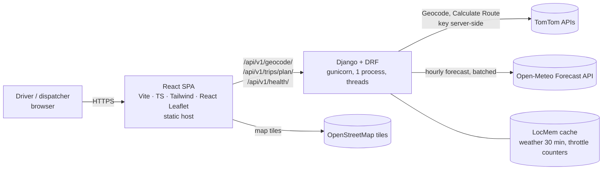
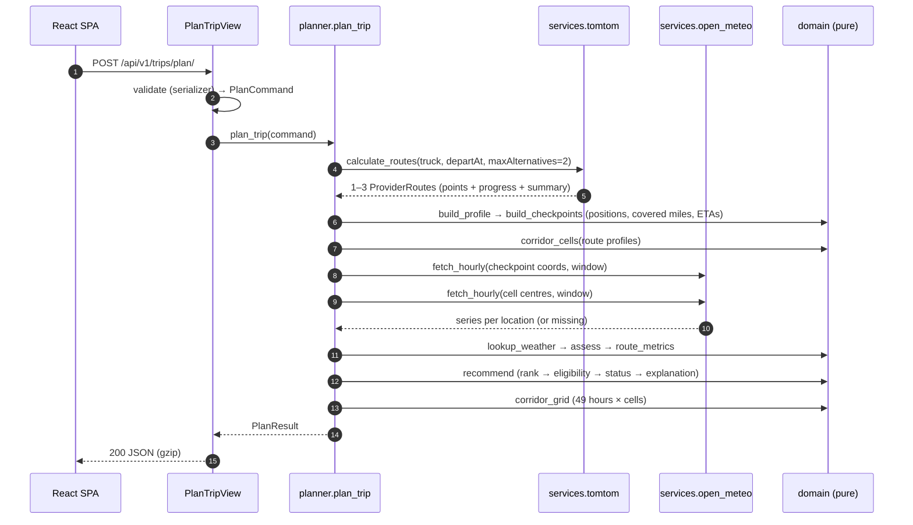

# Architecture

Supersedes blueprint §5, §7 and §12 where they differ. Each change is recorded in
[`DECISIONS.md`](DECISIONS.md).

## 1. Overview



- **Frontend:** a static SPA. It collects inputs, calls the backend, and draws everything. It holds
  no secrets. The slider uses only data already received.
- **Backend:** a stateless JSON API. It validates input, calls TomTom and Open-Meteo, runs pure
  domain logic, and returns one complete response per plan.

## 2. Backend

### 2.1 Layers

```
api/        HTTP only: serializers, views, response presenters, exception handler
planner.py  one orchestration function: plan_trip(command) -> PlanResult
domain/     pure logic — no Django, no network, no settings imports
services/   provider clients (TomTom, Open-Meteo) + shared HTTP helper + typed errors
```

Dependency direction: `api → planner → (domain, services)`. `services → domain.types` only.
`domain` imports nothing outside itself.

### 2.2 Modules (`backend/trips/`)

| Module | Responsibility |
|---|---|
| `domain/types.py` | Frozen dataclasses and enums: `LatLon`, `Place`, `PlanCommand`, `ProgressPoint`, `ProviderRoute`, `HourlySeries`, `WeatherAtCheckpoint`, `RiskAssessment`, `Checkpoint`, `RouteMetrics`, `Comparison`, `Recommendation`, `CorridorCell`, `CorridorGrid`, `PlannedRoute`, `PlanResult`, `Warning`, `RiskLevel`, `RecommendationStatus`, `DecidedBy` |
| `domain/geo.py` | Haversine distance, linear interpolation, conversion constants |
| `domain/risk.py` | PDF thresholds and load rules; `assess(wind, rain, snow, load)` → `RiskAssessment` |
| `domain/profile.py` | Cumulative distance and time per polyline point from TomTom progress (DEC-37); `locate(distance)` → position and time |
| `domain/checkpoints.py` | Checkpoint miles, covered miles, positions and ETAs |
| `domain/forecast.py` | Forecast-hour selection (DEC-24) and lookup in an `HourlySeries` |
| `domain/metrics.py` | Miles per level, known/unknown miles, average risk |
| `domain/recommend.py` | `rank`, `compare`, `status`, `recommend`, `explain` |
| `domain/corridor.py` | Corridor cells (DEC-34) and per-hour cell risk |
| `domain/timeutil.py` | `floor_to_hour`, `ceil_to_hour`, `nearest_hour`, UTC assertions |
| `services/errors.py` | `ProviderError` hierarchy: `ProviderNotConfigured`, `ProviderAuthError`, `ProviderRateLimited`, `ProviderTimeout`, `ProviderUnavailable`, `ProviderBadResponse`, `NoRouteFound` |
| `services/http.py` | `get_json()` with connect/read timeouts, one retry with backoff, status → error mapping, and safe logging (host + operation + status + ms; never the URL); `RedactSecretsFilter` for log records |
| `services/tomtom.py` | `geocode(query)` → `list[Place]`; `calculate_routes(origin, destination, departure)` → `list[ProviderRoute]` |
| `services/open_meteo.py` | `fetch_hourly(locations, start, end)` → `WeatherFetch` (series per location + failure counts); batching, bounded concurrency, unit check, cache |
| `planner.py` | Orchestrates one plan request; builds warnings; logs one summary line |
| `api/serializers.py` | Request validation (`PlanTripSerializer`, `GeocodeQuerySerializer`) |
| `api/presenters.py` | Domain result → JSON dicts exactly as in [`API_CONTRACT.md`](API_CONTRACT.md) |
| `api/views.py` | `HealthView`, `GeocodeView`, `PlanTripView` |
| `api/exceptions.py` | One DRF exception handler → the error format; JSON 404/500 handlers |

### 2.3 Plan request flow



**Weather window:** `start = floor_to_hour(departure)`;
`end = max(start + 48 h, ceil_to_hour(latest arrival))`. One window per plan.

### 2.4 External integrations

| Provider | Call | Timeouts | Retries | Caching |
|---|---|---|---|---|
| TomTom Geocode | `GET /search/2/geocode/{q}.json?countrySet=US&limit=5` | connect 5 s, read 10 s | 1 on timeout/5xx/connection | none (OPEN-10) |
| TomTom Calculate Route | `GET /routing/1/calculateRoute/{lat,lon}:{lat,lon}/json?travelMode=truck&routeType=fastest&traffic=true&maxAlternatives=2&routeRepresentation=polyline&extendedRouteRepresentation=distance&extendedRouteRepresentation=travelTime&computeTravelTimeFor=none&departAt=…` | connect 5 s, read 30 s | 1 on timeout/5xx/connection | none |
| Open-Meteo Forecast | `GET /v1/forecast?latitude=…&longitude=…&hourly=wind_speed_10m,rain,showers,snowfall&wind_speed_unit=mph&precipitation_unit=inch&timezone=GMT&timeformat=unixtime&start_hour=…&end_hour=…` | connect 5 s, read 15 s | 1 on timeout/5xx/connection; **not on 429** (DEC-53) | per location, 30 min (DEC-48) |

- Open-Meteo batches hold `WEATHER_BATCH_SIZE` locations (default 100, VF-5), with at most 3
  batches in flight. Only identical coordinates are de-duplicated. Checkpoints are fetched before
  corridor cells (DEC-52), because Open-Meteo counts every location against 600/min (VF-11); a
  typical long trip needs ≈ 150–300 locations at 25 mi (cells ≤ 200, DEC-34).
- TomTom geometry is dense (4.5k–15k points per route, VF-13). A real Chicago → Denver plan
  response is ≈ 1.2 MB raw / ≈ 265 KB gzipped; no simplification has been needed (DEC-28).
- A batch whose `hourly_units` differ from VF-2, or whose list length or array lengths are wrong,
  counts as failed (logged); its locations become missing.
- TomTom `vehicleWeight` is not sent (DEC-11).

### 2.5 Error handling

- Provider clients raise typed `ProviderError`s; the API exception handler maps them to the
  status codes in [`API_CONTRACT.md` §5](API_CONTRACT.md#5-errors-all-endpoints).
- Routing failure aborts the request. Weather failure degrades to UNKNOWN plus a warning.
- Unexpected exceptions are logged with a stack trace and returned as 500 `INTERNAL_ERROR`
  without details.

### 2.6 Security

| Concern | Control |
|---|---|
| API keys | `TOMTOM_API_KEY` only in backend env; sent as a query parameter (TomTom requirement), so URLs are never logged and `RedactSecretsFilter` masks `key=` in every log record (including urllib3 debug lines) |
| Secrets in Git | `.env*` ignored except `.env.example`; examples have empty secret values |
| Input | DRF serializers are authoritative; React escapes rendered text; no HTML from providers is rendered |
| CORS | `django-cors-headers` with an exact origin allowlist (`CORS_ALLOWED_ORIGINS`) |
| Hosts | `ALLOWED_HOSTS` from env; `DEBUG=false` by default; settings refuse to start without a secret key unless `DEBUG=true` |
| TLS behind a proxy | `DJANGO_BEHIND_TLS_PROXY=true` sets `SECURE_PROXY_SSL_HEADER`; optional `DJANGO_SECURE_SSL_REDIRECT` and `DJANGO_SECURE_HSTS_SECONDS` |
| Abuse and quota | DRF `ScopedRateThrottle`: plan 10/min, geocode 30/min; client IP from `REMOTE_ADDR`, or the `X-Forwarded-For` entry selected by `DRF_NUM_PROXIES` |
| CSRF | Not applicable: no cookies, sessions or auth |

### 2.7 Configuration

`backend/.env.example` lists every variable. Provider base URLs, timeouts, batch concurrency and
corridor constants are code constants, because they are not environment-specific.

## 3. Frontend

### 3.1 Structure (`frontend/src/`)

| Path | Responsibility |
|---|---|
| `main.tsx`, `App.tsx` | Entry; router (DEC-29) and providers |
| `api/` | `client.ts` (fetch wrappers, `ApiError` with contract code/details/retry hint), `types.ts` (mirror of the API contract), `useApiHealth.ts` |
| `state/TripContext.tsx` | Form draft, plan status/error, result, selected route/checkpoint/hour, `restored` / `outdated` flags; `submitPlan()` / `retryPlan()` with abort and a 120 s timeout; `newTrip()` |
| `state/tripStorage.ts` | Saved trip in `sessionStorage` (DEC-56): versioned result and UI records, 12 h expiry, structural validation on load, quota-safe writes |
| `layouts/AppLayout.tsx` | Workspace shell: night-indigo app bar with the numbered workflow and API status (≥ 1024 px), bottom tab bar (< 1024 px), offline banner, skip link |
| `pages/` | `LandingPage` (own header/footer), `PlanPage`, `RoutesPage`, `RouteDetailsPage`, `RecommendationPage`, `HeatmapPage`, `AboutPage`, `NotFoundPage` |
| `features/trip-form/` | `TripForm.tsx`, `LocationSearch.tsx`, `validation.ts` |
| `features/map/` | `index.ts` (Leaflet-backed exports, mocked in tests), `TripMap.tsx` (base map, OSM + Open-Meteo attribution, fit bounds), `layers.tsx` (`RouteLayer`, `CheckpointLayer`, `EndpointMarkers`, `CorridorLayer`), `popups.tsx` (`CheckpointPopup`, `RouteSummaryPopup`), `MapLegend.tsx` (key bar) |
| `features/routes/` | `RouteCard.tsx`, `RouteStats.tsx`, `CheckpointTable.tsx`, `CheckpointDetail.tsx` (shared by popups and the details inspector) |
| `features/recommendation/` | `criteria.ts` (criteria, runner-up, "why not" text), `DecisionTrace.tsx`, `ComparisonTable.tsx` |
| `features/forecast/` | `ForecastSlider.tsx` (slider, per-hour corridor histogram, driving window) |
| `components/` | `PageHeader` (h1, document title, `TripStrip` with Edit trip / New trip), `ResultNotice` (restored / outdated), `RouteShield`/`RouteSwatch`, `RouteProfile` (risk along a route), `ApiStatus`, `BrandMark`, `RiskBadge`/`RiskDot`, `RiskMilesBar`, `StateViews` (`StateView`, `LoadingState`), `PlanStates` (`NoTripState`, `PlanErrorState`), `WarningsBanner`, `RulesContent` (`RiskRulesTable`, `RankingList`) |
| `lib/` | `risk.ts` (level → colour/label/code/pattern, miles per level), `routes.ts` (route colours, rank order), `format.ts` (miles, durations, local dates, ages), `rulesCopy.ts` (display copy of the rules), `corridor.ts` (slider hour → time, cell styles), `bounds.ts`, `geo.ts`, `ui.ts` (button classes), `useMediaQuery.ts` |
| `assets/brand.ts` | Replaceable brand asset slots (DEC-40) |

### 3.2 State and data flow

- `TripProvider` holds `draft` (form), `status` (`idle | loading | error`), `result`,
  `selectedRouteId`, `selectedCheckpoint` and `hour`. On start it restores the last trip from
  `sessionStorage` (DEC-56) without any request; after each successful plan the result is saved
  once, and the small UI record is saved as it changes. `restored` labels restored results with
  their calculation time; `outdated` is true when the draft no longer matches `result.request`.
  `newTrip()` aborts any request and clears state and storage.
- Submit → `POST /trips/plan/` with a 120 s client timeout → on success, navigate to `/routes`.
  Inputs are preserved on error and can be retried.
- Pages that need a result show an empty state with "Plan a trip" when there is none.
- Heatmap: per-cell colours for all 49 hours come straight from the response. Moving the slider
  sets `selectedHour`; `CorridorLayer` then calls `setStyle` on the existing canvas rectangles
  inside one animation frame. No layers are recreated and no requests are made.

### 3.3 Map rendering

Leaflet with `preferCanvas` (one canvas renderer for routes and markers). Routes are
`Polyline`s with a white casing and a lettered shield marker (keyboard-selectable), checkpoints are
`CircleMarker`s, and corridor cells are imperative, non-interactive `L.rectangle`s in their own
canvas pane below the routes. Because the overlay canvas above takes pointer events, cells are
picked from the clicked position on the grid (`map.on('click')`). Tiles are greyed with a CSS
filter so only risk and routes carry colour. OSM tile attribution, plus "Weather: Open-Meteo
(CC BY 4.0)", appears in the attribution control. Maps fit the trip without animation (an animation
still running at unmount makes Leaflet read a removed pane); padding leaves room for the key bar.

### 3.4 Build

Vite/Rolldown splits vendor code into `react` and `map` (Leaflet) chunks so they cache
independently of app code (about 32 KB + 81 KB + 45 KB gzipped).

## 4. Testing boundaries

| Layer | Test | External calls |
|---|---|---|
| `domain/` | pytest unit | none |
| `services/` | pytest with `responses` | mocked (synthetic TomTom fixtures, recorded Open-Meteo fixture) |
| `planner.py` | pytest integration | services mocked |
| `api/` | DRF client contract tests | planner/services mocked |
| live | `pytest -m live` | real (Open-Meteo always; TomTom only with a key) |
| frontend | Vitest + RTL | `fetch` mocked; map components mocked |
| E2E | Manual checklist + headless Chrome screenshots | real backend |

See [`TEST_PLAN.md`](TEST_PLAN.md).
